# Adaptive route graph - implementation contract

This is an in-progress M4 contribution. It does not advertise a new device
capability, accept a graph policy or change the installed client's routes.
The complete stage is tracked separately from the accepted v77 device/runtime scope.

The [closed metadata contract](../contracts/v1/route-graph.schema.json) describes
at most 500 profiles,4096 directed edges,64 templates and 16 destination/check
groups. Each template has 1-4 slots. A group fixes its exit intent and comparison
features. Physical entry mode is determined locally. All hops and edges must
support the requested capabilities and the last hop must have the exact exit
class. A valid graph may have no eligible path on the current network; that is
not permission to fall back to direct traffic.

Metadata IDs bind one-to-one to an independently authorized immutable catalogue.
Metadata cannot grant access to another provider or inject transport credentials.
Actual protocol capabilities and TLS/SSH policies are checked separately against
the normalized profile. Declared exit metadata is not proof of the observed exit.
Each route group uses its bound check profile; metrics from incompatible check
profiles cannot be compared as interchangeable latency samples.

Both Go and Kotlin must reject duplicate/unknown/case-substituted fields,
malformed UTF-8, missing/null required containers, duplicate identifiers, invalid
references and edge capabilities outside their endpoints. Compute template
cardinality before expansion. The conservative sum of unique referenced templates
per exit intent must not exceed 4096; reject it explicitly rather than truncate it.
The entire UTF-8 metadata is limited to 262144 bytes. Individual limits need not
all fit simultaneously within that byte bound. Shared conformance fixtures are
required before this contract participates in policy activation.

## Runtime ownership decision

The existing embedded engine constructs a static graph. Its pinned upstream
[manager](https://github.com/AlwaysBusyStack/sing-box/blob/476d2436e84995f97fb3af605934cf07d3f95907/adapter/outbound/manager.go)
can remove an entry before rejecting a dependency, and starts a replacement
before committing registry state. Dynamic candidates must therefore use a private
bounded pool, preserving the active and draining paths until ownership ends.
Never mutate or remove a live configured adapter to probe a candidate.

The pinned service helper's
[ContextWith](https://github.com/SagerNet/sing/blob/v0.8.10/service/context.go)
registers into the existing context registry. A candidate must first call
`service.ExtendContext` to clone that registry, then substitute its private
outbound manager. Parent router/platform/lease services remain bound to the
current native runtime. A partial construction failure cancels and retires only
that candidate. No separate NetBird SDK or identity is cloned into a proxy path.

```mermaid
flowchart LR
    P[Signed policy and authorized catalogue] --> V[Closed graph validation]
    V --> F[Finite cursor and local eligibility]
    F --> A[Shared resource admission]
    A --> C[Private candidate construction]
    C --> H[Bound group checks through exact path]
    H --> S[Fresh context-bound selection proof]
    S --> X[Atomic active-path change]
    X --> D[Previous path drains under ownership limits]
```

All resident native adapters share the local cap, including configured, active,
draining and probing entries. Recovery and active confirmation take priority over
optional exploration/diagnostics/telemetry. Capacity exhaustion defers work and
reports incomplete coverage. A metadata-valid path is not a fresh probe result;
neither a cached score nor a warm hint authorizes selection. Negative hints have
finite context-sensitive quarantine and cannot carry authority across a changed
network, intent, policy dependency or engine generation.

## Required remaining implementation and acceptance

Go/Kotlin semantic conformance has accepted CI in [Android PR65](https://github.com/nd4y/syn443-android/pull/65)
and [Control Plane PR40](https://github.com/nd4y/syn443-control-plane/pull/40).
The remaining scope includes native pool/lifecycle tests, shared admission and memory,
immutable source preview/issuance fences,
signed capability gating, client/UI integration and actual Wi-Fi proxy-chain
failure/recovery on Xperia. Required Actions and original-state restoration remain
mandatory. No physical LTE, natural Doze, unplugged energy or endurance gate is
closed by this stage's synthetic network-mode cases.

The current source adds shared positive vectors, 21 path queries, 60 closed-failure
fixtures, exact byte/catalogue/combinatorial bounds, concurrent-read ownership,
redacted diagnostics and fuzzing. Kotlin also checks deterministic bounded cursor
results against the same paths and cross-language identities. These passed exact Actions [43701539388](https://github.com/nd4y/syn443-android/actions/runs/43701539388)
and [43700009850](https://github.com/nd4y/syn443-control-plane/actions/runs/43700009850).
The private constructor has separate [accepted evidence](https://github.com/nd4y/syn443-android/actions/runs/43715523260).
No graph policy decoder or capability is enabled.
