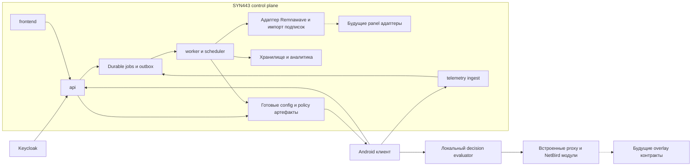

# Техническое задание на VPN клиент SYN443

Версия 0.6 от 19 октября 2026 года. Название продукта - **SYN443 - Secure Your Network** («Защити свою сеть»). SYN также отсылает к началу TCP-соединения, 443 - к привычному порту HTTPS и используемых туннелей. SYN443 control plane управляет пользователями, устройствами, политиками и подключаемыми ресурсами; клиент выбирает рабочие пути и объединяет источники VPN-доступа. Статус: проект ТЗ для согласования. Домены и сроки выпуска пока не назначены. Единственная пользовательская URI-схема приложения - `syn443://`.

Нужно создать Android-приложение для друзей, коллег и других приглашённых пользователей. Пользователь входит через Keycloak либо привязывает устройство по приглашению администратора, нажимает одну кнопку и получает настроенное подключение. Администратор через веб-панель назначает источники профилей, маршрутизацию, DNS, режимы сети, балансировку, права пользователя и параметры диагностики. SYN443 control plane является самостоятельной системой управления. Существующая Remnawave подключается к ней через API как внешний ресурс; её разрешённая выдача объединяется с подписками других VPN-провайдеров.

Основное требование SYN443 - интеллектуальный автономный клиент: он обнаруживает доступные разрешённые пути, строит пригодные цепочки и восстанавливает полезный доступ при изменениях сети. Приоритеты алгоритма в строгом порядке: стабильность и обработка исключений, энергоэффективность, скорость, точность измерения качества. Правильность назначения, права, TLS-валидация и запрет утечек являются обязательными условиями, а не предметом компромисса. Требование «в любых условиях» означает поиск среди технически возможных разрешённых конфигураций; оно не создаёт доступ без физической сети или рабочего пути.

## 1 Объём первой версии

Все перечисленные пользователем функции входят в целевой выпуск 1.0: HTTP, SOCKS, VLESS с XHTTP, NetBird, SSH, группы выбора прокси, полное provisioning, четыре сетевых режима, подробная телеметрия, журналирование и глубокие проверки. Внутренние этапы разработки могут выпускаться последовательно, но версия с отсутствующим обязательным протоколом не считается выполнением этого ТЗ. Также обязательны ручная привязка через ссылку/QR без Keycloak, мобильное администрирование, редактирование своего конфига на телефоне с публикацией на сервер и поставка всех VPN-движков встроенными отдельными модулями. Интеллектуальный поиск/оценка цепочек, контекстная память о сбоях, гибкие профили проверок маршрутов и поставляемые через control plane версии decision policy с тестовыми группами являются обязательным ядром 1.0.

Предлагаемые границы: один оператор сервиса, пользователи только по приглашению, без платежей, продажи подписок, публичной регистрации и маркетплейса. Первоначальное распространение - подписанный APK с проверяемыми обновлениями. Google Play и несколько независимых организаций - отдельные этапы. Для 1.0 планируются один подключённый API-ресурс Remnawave, внешние подписки и NetBird. Несколько Remnawave, адаптеры x-ui/3x-ui, Tailscale, ZeroTier и аналогичные будущие системы предусмотрены только в архитектуре и контрактах; их рабочая реализация, runtime-переключение и end-to-end испытания не входят в 1.0.

Сервер управления передаёт конфигурацию и принимает диагностику. Пользовательский интернет-трафик не должен проходить через него, если он отдельно не настроен как прокси. Ресурсы NetBird остаются закрытыми для пользователей, которым доступ не назначен.

## 2 Подтверждённые требования и предлагаемые решения

| Категория | Содержание |
| --- | --- |
| Требование владельца | Единый вход, назначение полного конфига из панели, объединение Remnawave и внешних подписок |
| Требование владельца | HTTP, SOCKS, VLESS/XHTTP, NetBird, SSH, балансеры |
| Требование владельца | Домашний Wi-Fi, любой Wi-Fi, LTE с белыми списками, обычный LTE |
| Основное требование владельца | Интеллектуальный автономный клиент: стабильность/исключения, затем энергия, скорость, точность измерений |
| Требование владельца | Детальная телеметрия, подробные логи, произвольные валидные профили проверок и режим одной кнопки |
| Требование владельца | Полный редактор на своём телефоне, двусторонняя публикация и мобильное администрирование |
| Требование владельца | Привязка ссылкой/QR без Keycloak и отдельные встроенные модули VPN-движков |
| Требование владельца | Самостоятельный SYN443 control plane, Remnawave как подключаемый API-ресурс |
| Архитектура без реализации в 1.0 | Несколько Remnawave, x-ui/3x-ui; будущие overlay-провайдеры Tailscale/ZeroTier |
| Сохранённое продуктовое правило | NetBird предпочитает прямое P2P; relay используется при недоступности прямого пути |
| Требование владельца | Поиск подходящих путей и цепочек в restricted и обычных сетях, с отдельным выбором RU/зарубежного выхода; ручной override сохраняется |
| Предлагаемая реализация | Kotlin/Compose, единый VpnService, встроенные движки, decision evaluator и микросервисы control plane |
| Требует согласования | Объём хранения телеметрии, минимальный Android, бюджет инфраструктуры, точный набор внешних провайдеров |

В прежнем NekoBox режим белых списков включался вручную. Новое требование одной кнопки предполагает автоматизацию, поэтому она явно выделена как новое решение, а не считается уже согласованным свойством старого клиента.

## 3 Пользовательские сценарии

**Первый запуск через Keycloak.** Приложение само предлагает вход, открывает системный браузер и после аутентификации проверяет право доступа на сервере. Если доступ разрешён, оно регистрирует устройство, загружает персональный конфиг и предлагает включить VPN. Пользователь не выбирает формат подписки и не копирует URL. Системное разрешение VPN и необходимые разрешения Android подтверждаются на устройстве.

**Обычная работа.** Кнопка включена, приложение само поддерживает подключение, обновляет разрешённые профили, выбирает путь и восстанавливается после смены Wi-Fi/LTE, сна и кратковременных обрывов. Пользователь видит «Работает», «Восстанавливаем соединение», «Доступен только интернет», «Нужен вход в Wi-Fi» или конкретную причину недоступности.

**Изменение выдачи.** Администратор добавляет пользователю источник стороннего провайдера, обновляет политику или назначает NetBird. Клиент получает новую ревизию, проверяет её, применяет и отправляет подтверждение либо причину отказа. Повторный ввод ссылок пользователем не нужен.

**Неисправность.** Пользователь нажимает «Проверить подключение». Клиент проверяет сеть, DNS, TLS, выходы и назначенные внутренние ресурсы, показывает вывод и предлагает отправить бандл поддержки. Базовая диагностика также работает автоматически.

**Выключение.** Нажатие «Выключить» отменяет намерение автоподключения, останавливает VPN и прекращает активные проверки путей. Если включён системный always-on/lockdown, UI объясняет управление через Android и не обещает обход системной политики.

**Редактирование на своём телефоне.** Администратор получает серверную конфигурацию, открывает её редактор, меняет маршрутизацию, профили или параметры движка, при необходимости проверяет их локально и нажимает «Опубликовать на сервер». Сервер проверяет права и базовую ревизию, создаёт новую версию, подписывает эффективный конфиг и возвращает статус доставки/активации.

**Мобильное управление.** Администратор нажимает «Администрирование», выбирает свой или чужой клиент, назначение, источник либо серверную настройку, вносит правку, смотрит diff и адресатов, публикует и видит результат применения. Личное VPN-соединение телефона не должно меняться из-за редактирования чужого клиента.

**Ручная привязка.** Администратор создаёт приглашение конкретному пользователю, передаёт ссылку или QR. Приложение показывает доверенный сервис и назначение, привязывает ключ устройства и при необходимости ждёт подтверждения администратора. После подтверждения получает конфиг без входа пользователя в Keycloak.

## 4 Архитектура



Компоненты SYN443 control plane: API пользователей и устройств; реестр внешних API-ресурсов; адаптер Remnawave; адаптеры источников подписок; каталог нормализованных профилей; компилятор назначений; реестр контрактов overlay-провайдеров; сервис публикации подписанных конфигов; приём телеметрии; обработка бандлов; веб-панель; аудит. Типы будущих адаптеров не означают наличие рабочих интеграций.

Предлагаемый начальный стек: Go-сервисы api/worker/telemetry-ingest, отдельный React/TypeScript frontend, PostgreSQL для конфигураций, аудита и начальных долговечных jobs/outbox, S3-совместимое хранилище бандлов, Keycloak для OIDC. Общие backend-модули могут жить в одном репозитории, сервисы развёртываются отдельно. Prometheus/Grafana наблюдают сервисы/очереди; отдельное аналитическое хранилище добавляется при подтверждённой необходимости. Эти компоненты не участвуют синхронно в каждом выборе пути телефона.

Android: Kotlin/Compose, Room для локального состояния, Android Keystore для защиты ключей и шифрующих ключей, единый foreground VpnService и ограниченные фоновые задания. Встроенные VPN-движки поставляются отдельными версионированными модулями. UI, оркестратор, routing/TUN и модули взаимодействуют через общий engine-api и адаптеры; конкретные native-процессы и границы изоляции фиксируются на этапе 0. Несколько модулей не означают несколько системных VPN.

Android допускает один активный VPN-сервис на пользователя или рабочий профиль. Поэтому NetBird и прокси должны работать внутри одного движка, без одновременного запуска отдельного официального NetBird VPN. Системное согласие VPN нельзя заменить серверной настройкой. [Android VPN](https://developer.android.com/develop/connectivity/vpn).

### Архитектурные инварианты и проверка осуществимости

ARC-01. Нумерованные требования обязательны в пределах объявленного scope; пример JSON не заменяет нормативную схему. Начальные численные defaults являются reference policy v1 и могут изменяться версионированной policy внутри hard limits. До функциональной реализации поставляются OpenAPI/JSON Schema, transition table и conformance fixtures; противоречие разрешается через ADR с отражением в schema/tests, а не молчаливой трактовкой разработчика.

ARC-02. Первый gate - вертикальный Android прототип до полной панели: физическая Network/TUN binding, прямой путь, двухпереходная RU-ingress/NON_RU-exit цепочка, NetBird/internal probe, смена Wi-Fi/restricted cellular, cache/circuit breaker, получение policy и offline rollback. Он включает искусственные отказы ingress/exit/DNS/check target, native hang/crash и ресурсные замеры. Все обязательные протоколы остаются в scope1.0; порядок работ снижает основной технический риск.

ARC-03. Все фоновые результаты несут context token: networkEpoch, activationGeneration, configRevision, algorithmRevision, engineGeneration и dependency hash. Один activation coordinator сериализует apply/mode switch/secret rotation; устаревший результат не меняет active/desired pointer. Worker compilation обновляет desired pointer только по CAS publication revision; поздний job не возвращает старую версию.

ARC-04. Activation gate описывается по intent: required/optional checks, baseline старой версии, timeout, допустимость degraded и критерий regression. Невалидная схема/подпись/capability - reject до запуска; невозможность запустить новый engine - rollback; внешний target, который не работал и на baseline, - degraded по policy. Candidate retry требует нового evidence, а не просто следующего poll.

ARC-05. Разрешённый граф конечен и объявлен шаблонами ingress/transit/egress с cardinality/edge constraints. Reference limit: до4096 различных цепочек на intent, четыре proxy hops, до64 resident frontier states плюс компактный cursor; каталог500профилей не означает500 в каждой позиции четырёх hops. Preview вычисляет/оценивает верхнюю границу, превышение отклоняется с предложением сузить шаблон. Нельзя незаметно обрезать хвост и затем заявить полный coverage. Порядок enumeration и продолжение детерминированы; на малом конечном fixture полнота обхода проверяется.

ARC-06. Единый admission controller на устройстве обслуживает recovery, обязательное подтверждение активного пути, явную диагностику, исследование резервов и telemetry в таком порядке. Он учитывает общие sockets/bytes/CPU-time/queue budgets и conservative handshake/redirect/retry overhead. Low-priority jobs могут быть отложены/отменены; critical recovery использует общий reserve, не отдельный лимит каждого компонента. UI cancel подтверждается не позднее2секунд, native stop - bounded lifecycle, а не UI wait.

ARC-07. Эталонный comparator даёт rank tuple: stabilityClass, energyClass, latencyBand, confidenceClass, stablePathId; меньше лучше. До сравнения выполняются жёсткие eligibility filters; они не являются trade-off. Измерения целочисленные/квантизованные; NaN/overflow/unknown явно обработаны. Thresholds, окна, aging, PRNG/jitter и event order включены в reference policy и одинаковые Android/replay fixtures; promotion после evidence, hard failure demotion немедленно. Новые кандидаты получают отдельную bounded exploration, а не вечное проигрывание старой истории.

| Измерение reference policy v1 | Определение |
| --- | --- |
| Eligibility | Права/capabilities/exit/защита транспорта и свежий обязательный predicate проходят; иначе путь не выбирается |
| Stability0 stable | Минимум5релевантных результатов в окне20последних за10минут, последние3успешны, failures не более5%, hard failure отсутствует; continuous uptime учитывается отдельно |
| Stability1 provisional | Обязательная проба прошла, но stable evidence недостаточно; отсутствие данных не считается failure |
| Stability2 degraded | Путь полезен по required predicate, но имеет допустимую деградацию optional/quality checks |
| Energy reference classes | Low: не более2KiB/min,1нового transport handshake/min и1активного резерва; medium: не более8KiB/min,4handshakes/min и2резервов; high: выше либо unknown. Берётся худший из трёх классов, учитываются keepalive/консервативный overhead |
| Latency | p95 прикладных end-to-end проб, band по25ms; недостаток выборки явно обозначен, скорость не обходит первые два класса |
| Freshness/confidence | Тип evidence и его TTL, необходимый для required check; stale не равен failure, активный путь показывается с соответствующей свежестью |
| Tie и switches | Совпавшие классы разрешаются stablePathId; смена исправного активного пути дополнительно ограничена AUTO-06 |

Сравнение latency допустимо только внутри одного intent и явно сопоставимого quality metric group; ping и HTTP разных targets не усредняются в общий рейтинг. Пороги energy и freshness обязательны в каждом bundle, не угадываются клиентом. Baseline fixture содержит fixed thresholds и ожидаемые rank/actions для каждого перехода; изменивший их релиз является новой policy revision.

## 5 Использование существующего форка

Предлагается новый продукт и новый пользовательский интерфейс с повторным использованием проверенных компонентов текущего форка. Необходимо сохранить исправления переходов сети, корректное завершение вложенного HTTP/2/gRPC, сбор native crash, редактирование секретов в диагностике и модель ADB API.

Перед переносом составляется реестр модулей, зависимостей, лицензий, локальных патчей и покрывающих их тестов. Поддержка XHTTP и встроенного NetBird в нашем форке не считается автоматически доступной в произвольной версии upstream sing-box.

UI эксперимента, текущие идентификаторы БД и JSON ядра не становятся публичным API нового продукта. Стабильный контракт конфигурации описывается независимо от версии native-движка. Обновление ядра проходит всю матрицу протоколов и handover.

Существующий телефон и его рабочие настройки не изменяются в рамках подготовки этого ТЗ. Миграция пользователей и инфраструктуры выполняется отдельным этапом с резервной копией и откатом.

### Модули VPN движков

MOD-01. Все требуемые выпуском 1.0 движки встроены в APK отдельными исходными и сборочными модулями. Нельзя требовать от пользователя установки отдельного NetBird, Xray, SSH-приложения или скачивания бинарника перед первым подключением.

MOD-02. Предлагаемые границы: engine-api, engine-orchestrator, engine-singbox для HTTP/SOCKS/VLESS/XHTTP/SSH, engine-netbird и адаптер связи NetBird с транспортами proxy engine. Один движок может реализовать несколько протоколов; отдельный протокол не обязательно является отдельным native-процессом. Новый движок подключается собственным модулем по тому же контракту. Для будущих overlay-движков предусматривается тот же контракт расширения, но модули engine-tailscale/engine-zerotier не реализуются, не собираются и не включаются в APK 1.0.

MOD-03. Общий контракт включает capabilities, validate/compile, prepare/start/stop с deadline, dial TCP/UDP или packet endpoint по объявленным возможностям, привязку к physical network, health, структурированные события и metrics. Детали конкретного Go/JNI API не выходят в UI или публичную provisioning-схему.

MOD-04. Каждый модуль имеет engineId, собственную версию, upstream commit, список патчей, сборочный manifest, хеши, SBOM, лицензии и тесты. Зависимости фиксируются lock-манифестом релиза; недокументированный dirty checkout не считается воспроизводимой сборкой.

MOD-05. Обновление одного движка меняет версию его модуля и адаптер при необходимости, не требует переписывать экраны и бизнес-модель. Пакетная сборка может перелинковать общие native-библиотеки; независимость модулей не означает гарантированного ABI между произвольными upstream версиями.

MOD-06. CI проверяет совместимость engine-api, ядра оркестрации и адаптеров по матрице версий. Неподдерживаемая комбинация не публикуется. Замена NetBird или proxy engine обязательно проверяет их аварийную VLESS-цепочку, DNS, handover и завершение транспорта.

MOD-07. В первой версии новые бинарные версии модулей доставляются обновлением подписанного APK; приложение и панель показывают состав и версии движков. Provisioning может выбирать уже встроенный движок/режим, но не исполняет код по URL из конфигурации. Независимая загрузка исполняемых модулей без обновления APK не входит в 1.0.

MOD-08. Модули используют единый VpnService. Android supervisor владеет основным TUN descriptor, Network binding и поколениями; native host получает контролируемый duplicate descriptor и transport context. В1.0 один согласованный Go runtime для proxy и NetBird модулей в отдельном native-host процессе; UI и supervisor не загружают этот runtime. Повторный start до подтверждённой остановки/смерти предыдущего поколения запрещён. Прототип ARC-02 проверяет эту границу до full implementation.

MOD-09. Native crash/hang/stop timeout диагностируется по engine/version/generation. JVM timeout сам по себе не доказывает остановку Go: supervisor при необходимости завершает только принадлежащий приложению native-host, дожидается его смерти/освобождения identity lock и ограниченно восстанавливает процесс. Пока TUN удерживается supervisor, потоки блокируются по fail policy. Миграция/откат локального состояния согласуются с ENG-03; сторонние процессы/VPN не завершаются.

MOD-10. Поставка включает инструкции воспроизводимого обновления каждого движка, тесты чистой сборки и 16KiB alignment для native-библиотек. Stage0 проверяет реальные ограничения Go runtime, linker/JNI и изоляции до выбора бинарных границ. [Android modularization](https://developer.android.com/topic/modularization/patterns), [динамическая загрузка кода](https://developer.android.com/privacy-and-security/risks/dynamic-code-loading).

## 6 Пользователи и права

Роли: владелец сервиса, администратор конфигурации, специалист поддержки, пользователь. Права проверяются сервером для каждого объекта и операции.

Администратор назначает пользователям и группам подписки, профили, группы выбора, маршруты, DNS, NetBird и настройки. Для объекта задаются получатели, доступные сетевые режимы и разрешённые операции: использование, просмотр параметров, экспорт, локальное изменение, диагностика. Отдельные права: редактирование локального черновика, локальный тест, создание серверного черновика, публикация на устройство/пользователя/группу/шаблон, управление чужими устройствами, приглашениями и настройками сервера. Сервер проверяет их независимо от отображения кнопок и способа входа.

Пользователь видит только свою эффективную выдачу. Специалист поддержки видит техническое состояние разрешённых устройств и очищенную диагностику; доступ к секретам и публикация политик ему по умолчанию не разрешены. Все операции публикации, изменения назначений, выдачи секретов, отзыва и скачивания бандлов аудируются.

Закрытие профиля в UI и запрет экспорта уменьшают случайное распространение, но не делают секрет недоступным владельцу скомпрометированного телефона. Реальное ограничение доступа обеспечивается индивидуальными учётными данными и проверками на прокси или NetBird.

## 7 Аутентификация и регистрация устройств

AUTH-01. Основной вход - OIDC Authorization Code + PKCE S256 через системный браузер/Custom Tabs. В APK нет клиентского секрета и формы, перехватывающей пароль Keycloak. Проверяются state, nonce, issuer, audience, подписи и точные redirect URI. [RFC 8252](https://www.rfc-editor.org/rfc/rfc8252), [Keycloak OIDC](https://www.keycloak.org/securing-apps/oidc-layers).

AUTH-02. После Keycloak/OIDC или одобренного QR enrollment сервер регистрирует случайный deviceId и ключ устройства, независимо от IMEI/IMSI/MAC. Доступ к device API использует короткоживущую сессию, связанную с ключом по SEC-04; Keycloak user identity, device session и admin session различаются. Приглашение не создаёт административную сессию; ID устройства без доказательства владения ключом не является авторизацией.

AUTH-03. Пользователь SYN443 идентифицируется независимо от внешней панели. Существующего пользователя Remnawave связывают по паре resourceId/externalUserId либо одноразовой проверке владения в этом ресурсе. Совпадение email, имени или одинакового externalUserId в двух ресурсах само по себе не выдаёт чужую подписку. Ограничение числа устройств настраивается администратором.

AUTH-04. Отзыв устройства блокирует новые конфиги, секреты и сессии. Прокси-учётные данные и NetBird peer отзываются отдельно через адаптеры. Отключение только в нашей панели не гарантирует прекращения работы ранее выданного стороннего конфига.

AUTH-05. Выйти из аккаунта и выключить VPN - разные действия. Выход удаляет локальные сессии и секреты приложения, завершает VPN и снимает локальную регистрацию; серверный отзыв выполняется идемпотентно. Системные настройки Android пользователь меняет средствами ОС.

### Вход и ручная привязка

ONB-01. При отсутствии действующей регистрации на первом экране есть «Войти» и «Сканировать QR / открыть приглашение». Обычный запуск предлагает Keycloak, а запуск по корректному приглашению сразу ведёт в ручную привязку без страницы IdP.

ONB-02. Успешный вход в Keycloak подтверждает личность, но не право пользования сервисом. Сервер отдельно проверяет приглашение/назначение, статус пользователя и лимит устройств. Для запрещённого или ожидающего назначения аккаунта показывается соответствующее состояние; чужой, общий или демонстрационный конфиг не выдаётся.

ONB-03. После разрешённой регистрации клиент автоматически получает эффективную конфигурацию и показывает готовность к включению VPN. Повторный запуск использует действующую сессию либо разрешённую offline lease. Необходимость повторного входа, отсутствие назначений и отсутствие сети различаются.

ONB-04. Пользователь не вводит вручную серверы, DNS, VLESS UUID или подписочные URL. Операционное согласие Android на VPN сохраняется. Ручная привязка и OIDC приводят к одной модели пользователя/устройства и одинаковым правилам выдачи, отзыва и аудита.

## 8 Remnawave и внешние подписки

SUB-01. Remnawave подключается к SYN443 control plane как внешний API-ресурс через отдельный backend-адаптер; это не внутренняя БД, обязательный backend пользователей SYN443 или источник глобальных ролей. Remnawave продолжает управлять своими пользователями, доступом к нодам и лимитами. В 1.0 требуется подключение одного такого ресурса с минимальными правами: серверный API получает доступные пользователю назначения/метаданные и разрешённую выдачу, включая получение subscription payload при необходимости. Прямой доступ SYN443 к БД Remnawave и встроенный fork её панели не требуются.

SUB-02. Связь с Remnawave учитывает реально выданные пользователю профили и исключения хостов. Новая панель может сужать права источника, но не расширять их до полного каталога нод. Internal Squads задают доступ к inbound, External Squads могут менять выдачу и шаблоны. Формат подписки зависит от клиента. [Remnawave Squads](https://docs.rw/learn-en/squads/), [Templates](https://docs.rw/learn-en/templates/). Все внешние идентификаторы и правила сверяются в контексте resourceId. API endpoint, credentialRef, версия API, права и состояние ресурса задаются в SYN443; служебные credentials остаются на сервере.

SUB-03. Для каждой внешней подписки хранятся владелец, тип провайдера, защищённый URL/авторизация, способ загрузки, получатели, срок действия, метаданные квоты, разрешённые режимы, статус последнего обновления и последняя рабочая версия. Поддерживаются персональные источники одного пользователя и явно назначенные общие источники. Область назначения по умолчанию закрыта. API-ресурс панели и URL-источник подписки - разные сущности: источник может ссылаться на resourceId, но не выдаётся за самостоятельный экземпляр панели.

SUB-04. Способы загрузки: сервером; самим устройством для подписок с привязкой к устройству/IP; ручной импорт администратором. Выбор фиксируется на источнике. Нельзя обходить лимит устройств подменой HWID или выдавать серверную загрузку за работу пользовательского устройства. Собственные ссылки пользователя, если добавление разрешено, по умолчанию доступны только ему.

SUB-05. В первой версии импортеры принимают поддерживаемое подмножество URI/base64, sing-box JSON, Xray JSON и Mihomo YAML. Матрица поддерживаемых полей обязательна. Неподдерживаемый протокол или поле показывается явно; неизвестные параметры нельзя молча отбрасывать.

SUB-06. Чужой полный конфиг разбирается как недоверенный источник профилей. Его маршруты, DNS, локальные listeners, external controllers, ссылки на файлы, скрипты и удалённые rule sets не получают автоматического приоритета над нашей политикой. Импорт маршрутов возможен только отдельным проверенным действием администратора.

SUB-07. Профиль имеет стабильный ID в пространстве своего источника. Дедупликация не склеивает учётные данные разных пользователей и источников. Переименование и перестановка строк не должны терять ручные назначения. При отсутствии внешнего ID используется документированное сопоставление; неоднозначность показывается оператору.

SUB-08. Загрузка идемпотентна, использует ETag/Last-Modified, ограничения размера и времени, backoff и изоляцию источников. Начальные лимиты: 10 MiB распакованного ответа, 5000 профилей на источник, 30 секунд загрузки. YAML не исполняет пользовательские теги. Защита от SSRF проверяет DNS, redirects и фактический адрес соединения; внутренние адреса разрешаются только для явно доверенных источников.

SUB-09. Пустой ответ, HTML вместо подписки, ошибка авторизации или резкое исчезновение профилей не удаляют последнюю рабочую выдачу автоматически. Кандидат помещается в карантин. Начальный порог проверки - исчезновение более 20% профилей или любого профиля, на который ссылается маршрут/цепочка. Явный отзыв доступа или подтверждённое истечение не подменяются бесконечным кэшем.

SUB-10. Обновление запускается по политике источника, по допустимому webhook и вручную. Типовое значение - раз в час с jitter, с учётом ограничений провайдера. Отказ одного источника не блокирует остальные.

SUB-11. Лимиты и сроки источника показываются с временем обновления. Клиентский расход является оценкой и не заменяет учёт провайдера. Трафик транзитных цепочек не суммируется повторно как пользовательский расход. Стоимость и остаток квоты могут участвовать в выборе выхода, но только при известных и достаточно свежих данных.

SUB-12. При выводе источника из эксплуатации панель показывает зависимости и предлагает замену или отключение. Публикация с висячими ссылками запрещена. Пользователь получает понятное состояние «подписка истекла», а не только сетевой timeout.

### Подключаемые API ресурсы

SYN443 control plane владеет своей моделью пользователей, устройств, назначений, provisioning и аудита. Внешние панели и overlay management системы являются подключаемыми ресурсами с собственными ID и правами. Реестр API-ресурсов и Android engine-api - разные уровни: серверный адаптер сам по себе не добавляет в APK новый сетевой протокол.

EXT-01. Архитектурная сущность ResourceInstance содержит resourceId, providerType, displayName, endpoint, apiVersion, credentialRef, enabled, capabilities, syncPolicy, revision и health/lastSync. providerType является расширяемым версионированным discriminator; в 1.0 работающий адаптер panel.remnawave поддерживает один ресурс.

EXT-02. Идентификаторы профилей, пользователей, нод, сетей и назначений внешнего API всегда включают resourceId и externalObjectId; credentialRef и state также изолируются по ресурсу. Для добавления второго экземпляра позднее не должны требоваться переименование существующих объектов или изменение публичного device provisioning API.

EXT-03. Контракт ResourceAdapter описывает discovery/capabilities, проверку соединения, чтение каталога и назначений, получение разрешённых конфигов/метаданных, нормализацию ошибок и sync checkpoints. Изменяющие операции вынесены в необязательные capabilities. API конкретного провайдера, включая login/token/session, не раскрывается Android-клиенту.

EXT-04. Набор прав SYN443 и права внешнего API пересекаются, а не объединяются. Нет автоматической выдачи полного внешнего каталога пользователям SYN443. Адресат и происхождение каждого выданного объекта объясняются через resourceId/sourceId; общая панель не превращает чужую подписку в общий ресурс без явного назначения.

EXT-05. Архитектура предусматривает несколько ResourceInstance одного типа и смешанные panel.remnawave, panel.x-ui, panel.3x-ui. Для x-ui и 3x-ui фиксируются отдельные типы/версии контрактов: совместимость конкретных API не предполагается. Диспетчер и хранение не завязываются на глобальный единственный URL/token Remnawave.

EXT-06. Работа с несколькими Remnawave и реальные адаптеры x-ui/3x-ui отложены. Для 1.0 не нужны параллельная синхронизация нескольких панелей, реальные запросы к x-ui/3x-ui, объединение каталогов нескольких API-панелей или готовые пользовательские сценарии их подключения. Импорт обычной подписки поддерживаемого формата, даже если её выдала такая панель, остаётся доступным по SUB-03-12 и не считается реализацией её API-адаптера.

EXT-07. Типы без реализованного адаптера имеют статус planned/not_implemented. Их нельзя активировать как working ресурс, публиковать клиенту как работоспособную интеграцию или показывать успешный health/sync. Полученный неподдержанный тип даёт структурированный отказ; UI может показывать его только как планируемую возможность.

EXT-08. Доступ к ресурсам имеет отдельные credentials, RBAC и аудит. Для каждого запланированы timeout, rate limit, backoff, pagination, reconciliation и изоляция ошибок. Удаление/отключение ресурса показывает зависимости и не оставляет висячие ссылки. Неуспешная загрузка не стирает последнюю разрешённую выдачу по SUB-09.

EXT-09. Согласование master data явное: SYN443 владеет device policy и публикациями; Remnawave владеет собственными proxy credentials, upstream лимитами и доступом к её нодам. Изменение эффективной политики SYN443 не переопределяет ограничения или БД провайдера. Для будущей двусторонней записи нужен отдельный field ownership и reconcile контракт.

EXT-10. Приёмка архитектурного расширения в 1.0 ограничена схемой данных, interface definitions, правилами namespace и синтетическими contract fixtures с совпадающими external IDs разных ресурсов. Это не реализация второго рабочего экземпляра или нового адаптера и не утверждение их end-to-end совместимости.

## 9 Единая модель конфигурации

CFG-01. Полная конфигурация включает профили, источники, цепочки, селекторы, маршруты, DNS, правила приложений, сетевые режимы, домашние сети, проверки, поведение отказов, телеметрию, логи, UI-права, обновления и разрешённые локальные переопределения. Обязательны также route graph/templates, профили проверки отдельных маршрутов, decision policy, условия circuit breaker/истории, бюджеты поиска и назначения версий алгоритма по cohort.

CFG-02. Системные разрешения, приватный ключ идентичности NetBird, ключ устройства, счётчики, кэши и живые результаты проверок являются локальным состоянием, а не переносимым конфигом. Панель задаёт политику их использования и показывает соответствие, но не выдаёт разрешение Android от имени пользователя.

CFG-03. Слои: базовый шаблон сервиса, назначения групп, пользовательская политика, политика устройства, разрешённые локальные значения. Для групп задаётся явный приоритет. Коллизия одинакового приоритета или конфликт взаимоисключающих маршрутов блокирует публикацию. Наследование прав может сужать, но не обходить запрет вышестоящей политики. Для каждого итогового поля панель объясняет источник.

CFG-04. Для полей задаётся locked, пользовательский выбор из списка либо свободное изменение в проверяемом диапазоне. Обновление сохраняет разрешённые локальные значения; удалённое переопределение показывается пользователю и аудируется. В режиме управления импорт/ADB не обходят эти права. Для администратора сервер может разрешить отдельную публикацию правок даже для locked полей обычного пользователя; право не выводится из наличия debug APK или ADB.

CFG-05. Конфиг - декларативный документ со schemaVersion, policyRevision, targetDevice, generatedAt, notBefore, refreshAfter, offlineUntil, requiredCapabilities, contentHash и отдельной подписью. Секреты выдаются адресно через ссылки на секреты и защищённые ответы. Телефон всё равно должен получить необходимые для подключения параметры; это не схема скрытия секретов от самого телефона. Документ ссылается на подписанный decision policy bundle с собственной версией, hash и required evaluator capabilities; активная пара configRevision/algorithmRevision фиксируется вместе.

CFG-06. Публикуется неизменяемая ревизия эффективного конфига для устройства. Она не содержит чужих профилей и URL исходных подписок, если устройству не требуется собственная загрузка. Собственный конфиг клиента не зависит от формата выдачи Remnawave и версии её API.

Пример логической структуры, не окончательная wire-схема:

```json
{
  "schemaVersion": 1,
  "policyRevision": 42,
  "targetDevice": "device-example",
  "requiredCapabilities": ["vless.xhttp", "netbird.direct", "netbird.vless"],
  "connectionPolicy": {
    "mode": "automatic",
    "allowedNetworkModes": ["home_wifi", "wifi", "cellular_restricted", "cellular"],
    "manualOverrideAllowed": true
  },
  "profiles": [
    {"id": "source-a/ru-entry", "type": "vless", "secretRef": "device-secret-1"},
    {"id": "mesh/personal", "type": "netbird", "connectionMode": "direct"}
  ],
  "chains": [
    {"id": "mesh-emergency", "dialOrder": ["source-a/ru-entry", "mesh/personal"]}
  ],
  "routingPolicyRef": "routing-main",
  "dnsPolicyRef": "dns-main",
  "healthPolicyRef": "health-main",
  "telemetryPolicyRef": "telemetry-main",
  "permissionsRef": "user-standard"
}
```

## 10 Доставка и применение конфигурации

PROV-01. Подпись проверяется доверенным ключом публикации, встроенным в приложение или полученным через заранее доверенную цепочку ротации. TLS и подпись конфига решают разные задачи. Корневой ключ не заменяется произвольным ответом сервера.

PROV-02. Обновление выполняется по этапам: скачать, проверить подпись/адресата/срок/возможности, проверить схему и ссылки, получить необходимые секреты, скомпилировать, выполнить preflight, сохранить кандидата, переключить движок, проверить критические пути, подтвердить активную ревизию. На каждом этапе есть timeout и код ошибки. Каждый apply использует immutable dependency snapshot и activationGeneration по ARC-03; внешняя недоступность отдельного target оценивается по activation gate, а не автоматически считается сломанным конфигом.

PROV-03. Desired, downloaded, validated, active и last-known-good ревизии показываются отдельно. HTTP200 при скачивании не считается успешным применением. Применение не перерегистрирует NetBird и не сбрасывает его идентичность. Локально изменённый тестовый конфиг показывается как local experiment с базовой серверной ревизией; он не выдаётся за подтверждённую серверную публикацию.

PROV-04. Активация имеет durable journal и состояния prepared/applying/committed/degraded/rolled_back/rejected. Snapshot включает config/policy/secrets/engine versions и gates. До переключения сохраняется разрешённый baseline; commit active pointer выполняется один раз. Ошибка нового native запуска или доказанная регрессия обязательного пути вызывает один bounded rollback; выключенный до обновления необязательный домашний сервис сам по себе отката не вызывает. Тот же отказавший candidate не активируется вновь до существенного изменения evidence. Revocation floor и expiry важнее возврата доступности.

PROV-05. Откат содержимого публикуется как новая ревизия с более новым порядковым номером. Воспроизведение старого подписанного документа не должно обходить отзыв. Откат локального кандидата допускается только к ещё разрешённой last-known-good версии. Сроки и security epoch проверяются по SEC-06; локальный возврат не обновляет offline lease и не возвращает отозванные секреты.

PROV-06. Недоступный control plane не останавливает действующий разрешённый путь. Начальные параметры - refreshAfter5минут при активном VPN и offlineUntil7суток; фактический предел определяется ближайшим expiry обязательного config/policy/credential и SEC-06. Access token/API session и offline lease - разные сроки. После истечения клиент блокирует управляемые пользовательские потоки согласно policy, сохраняя строго ограниченный доверенный management/re-auth recovery path, если он технически доступен. Этот путь не является общим direct fallback. При невозможности восстановления UI предлагает доступный Wi-Fi/действие пользователя; общий device kill switch требует Android lockdown.

PROV-07. Онлайн-устройство при доступном канале получает новую политику в пределах 5 минут, если не задан иной интервал. Отзыв сессии применяется при следующем обращении; принудительный отзыв уже выданного доступа требует поддержки конечного сервера. Офлайн-мгновенный отзыв не обещается.

PROV-08. Конфигурации и версии decision policy публикуются управляемым rollout: тестовое устройство, пилотная группа, последующие cohort и все разрешённые устройства. Назначение стабильно, стадии подтверждаются метриками, остановка/откат происходят по RLP-01-10. Обновление серверных сервисов, APK/движков, decision policy и пользовательских назначений имеют отдельные версии и совместимость.

## 11 Протоколы и цепочки

| Возможность | Обязательная поддержка | Проверка и ограничения |
| --- | --- | --- |
| HTTP | CONNECT, авторизация, защищённое TLS-соединение с HTTPS proxy | Обычный CONNECT переносит TCP; UDP без отдельного согласованного транспорта не объявляется |
| SOCKS | SOCKS5 TCP, авторизация, UDP ASSOCIATE при поддержке сервера | SOCKS4/4a как совместимость; UDP проверяется отдельно от TCP |
| VLESS | TCP, TLS/REALITY по матрице ядра, WS, gRPC, XHTTP | Параметры TLS/ALPN/SNI и XHTTP не теряются при импорте; каждый поддержанный режим проверяется отдельно |
| XHTTP | Совместимые stream/packet варианты и h2/h3 по возможностям зафиксированной сборки | Полная матрица клиент/сервер; HTTP/3 не считается запасным способом при блокировке UDP |
| SSH | TCP forwarding, пароль/ключ, проверка ключа сервера | Несовпадение host key блокирует соединение; удалённые shell-команды отсутствуют |
| NetBird | Встроенный IPv4 overlay, DNS, peer state, P2P, relay fallback | Прямой основной путь и аварийный через VLESS; отдельная ОС VPN не запускается |
| Группы | Ручной выбор, ordered fallback, лучший по score | Балансировка по соединениям только как отдельно разрешённая стратегия |

PROTO-01. Каждый профиль и цепочка объявляют возможности TCP/UDP, IPv4/IPv6, DNS через путь, типы транспорта и поддерживаемые параметры. Невыполнимые комбинации отвергаются до публикации. Для не поддержанного UDP указывается block либо явный отдельный маршрут; скрытый выход напрямую запрещён.

PROTO-02. Кандидаты маршрутов формируются из ориентированного графа разрешённых подключений. Конкретная цепочка - простой путь без циклов, с ограничением глубины, первоначально четыре proxy-перехода. Разрешённые комбинации задаются политикой и capabilities; каталог не обязан заранее перечислять каждую цепочку. UI показывает порядок входов и фактический конечный выход. Запрещены ссылки на себя, обход через защищённый служебный сокет и DNS-зависимость от ещё не поднятого пути.

PROTO-03. IPv4 интернет-трафик обязателен. Для IPv6 первая версия должна либо обеспечивать проверенный путь, либо явно блокировать его в политике; нельзя допускать незаметный прямой обход VPN. NetBird IPv6 не является обязательным для 1.0.

PROTO-04. Первая версия поддерживает один активный NetBird account/network на устройстве. Общая модель должна различать providerType, resourceId, networkId и локальную идентичность overlay, не делая NetBird единственным допустимым архитектурным типом. Одновременные overlay-сети, несколько NetBird сетей, Tailscale/ZeroTier и межсетевое объединение не входят в реализацию 1.0.

## 12 NetBird

NB-01. В обычной сети используются прямые management/signal и P2P пути. Relay разрешён только после неудачи прямого соединения или потери пути; начальный direct ICE timeout - 8 секунд, настраиваемый в проверяемом диапазоне. После relay сохраняются ограниченные попытки вернуться к P2P. Такое предпочтение соответствует модели NetBird. [Как работает NetBird](https://docs.netbird.io/about-netbird/how-netbird-works).

NB-02. В ограниченной сети при разрешённой автоматике включается отдельный проверенный вариант NetBird через VLESS. Внешние соединения этого варианта должны идти через выбранный VLESS путь без скрытого direct bootstrap; неподдержанные UDP-пути не обходят прокси. В UI явно различаются direct/through VLESS и P2P/relay. Это разные свойства соединения.

NB-03. Первоначальная выдача NetBird выполняется через однократное зачисление устройства или отдельную OIDC-интеграцию NetBird. Успешный вход в наш Keycloak не назначает пользователю доступ ко всем NetBird peers. Управляющий backend хранит служебный доступ к NetBird только на сервере. NetBird - первый реализуемый overlay-провайдер общего контракта OVL; его API/идентичность и формат peer не являются универсальными правилами для будущих систем.

NB-04. Для автоматического зачисления предлагаются одноразовые setup keys с минимальными группами и сроком жизни. Они передаются только конкретному устройству и удаляются после использования. Обновление политики, перезапуск и смена сети не создают нового peer. [NetBird setup keys](https://docs.netbird.io/manage/peers/register-machines-using-setup-keys).

NB-05. Ключ идентичности создаётся и хранится локально, не попадает в телеметрию, бандлы и обычный экспорт. Смена direct/VLESS сохраняет peer ID. Ключи и peer отзываются отдельно при удалении устройства.

NB-06. Отдельно показываются management, signal, relay, peers, выбранный upstream, ICE/P2P состояние, последнее рукопожатие, объём трафика и доступность назначенных ресурсов. Все разрешённые peers можно проверить ограниченным заданием; отсутствие ICMP не равно «peer выключен».

NB-07. Маршруты и DNS выдаются по фактическим назначениям NetBird и нашей политике. Широкий mesh CIDR не угадывается. Внутренние DNS-запросы не уходят публичному резолверу при сбое overlay. Конфликт маршрута NetBird с домашней сетью выявляется до активации.

### Расширяемая модель overlay интеграций

OVL-01. NetBird реализуется первым провайдером общей модели OverlayConnection: overlayId, providerType, resourceId, networkId, identityRef, engineRef, providerConfig, route/DNS policy, transportPolicy и capability requirements. Параметры NetBird хранятся в типизированном providerConfig, а не в обязательных полях всех будущих провайдеров.

OVL-02. Контракт overlay-адаптера разделяет серверные management операции и клиентский data plane. Он предусматривает enrollment/revoke/status по объявленным возможностям, lifecycle движка, получение назначенных маршрутов/DNS, состояние peers или аналогичных объектов и diagnostics. Провайдер без peer API не обязан имитировать модель NetBird.

OVL-03. Типы overlay.tailscale, overlay.zerotier и дальнейшие провайдеры предусмотрены как точки расширения. Их backend-коннекторы, auth flow, локальные движки/SDK, экраны специфичных настроек, телеметрия протокола, работающие профили и end-to-end испытания не реализуются в 1.0. Нет требования включить их бинарники в первоначальный APK.

OVL-04. Нет предположения, что API интеграция означает наличие туннеля: для будущего провайдера отдельно потребуются server adapter и совместимый embedded Android engine/adapter. Нужны capability negotiation, проверка лицензии, ресурсов, сетевого стека и взаимодействия с единым VpnService до включения реализации.

OVL-05. Прямое соединение, relay, UDP, IPv6, внутренний DNS, маршруты, подключение через VLESS и число одновременных сетей определяются capabilities конкретного провайдера. Свойства текущего NetBird не переносятся автоматически на Tailscale/ZeroTier; неподдержанная цепочка отвергается до активации.

OVL-06. Идентичности, токены, state directory и секреты разделяются по overlayId/provider/resource. Публикация политики не конвертирует идентичность одной сети в другую. Реализация 1.0 не объединяет автоматически peers, DNS-зоны или маршруты нескольких overlay-провайдеров.

OVL-07. Общий UI/health API показывает provider, сеть, управление, data plane, маршруты и фактический путь в пределах capabilities. В 1.0 данные отдаёт только NetBird; planned provider возвращает not_implemented и не получает ложный Connected. Контракт проверяется синтетическими моделями без реальных подключений будущих систем.

## 13 Четыре режима сети

| Режим | Выбор | Интернет | Внутренние ресурсы и NetBird |
| --- | --- | --- | --- |
| Домашний Wi-Fi | Совпадение назначенной домашней сети с доступными признаками | Прямые разрешённые направления и выбранный внешний выход по политике | Домашние ресурсы напрямую, где это назначено; NetBird direct |
| Любой Wi-Fi | Wi-Fi, который не подтверждён как домашний | Split/full tunnel по политике; проверка captive portal | NetBird direct, relay при невозможности P2P |
| LTE с белыми списками | Ручной выбор либо подтверждённая совокупность проверок | Проверенные входы, например RU VLESS с последующим нужным выходом | NetBird через разрешённый VLESS при недоступности direct |
| LTE | Обычная мобильная сеть, включая 5G | Split/full tunnel по политике | NetBird direct, relay fallback |

MODE-01. Вид транспортной сети и её пригодность - отдельные признаки. LTE/5G не означает наличие белых списков. Ошибка одного сайта не является достаточным основанием для смены режима.

MODE-02. Предлагаемый приоритет: временный ручной override, явно назначенная политика устройства, автоматическое определение. Ручной override виден на главном экране и действует до выбранного пользователем срока или изменения сети. Администратор задаёт разрешённые режимы и право override.

MODE-03. SSID/BSSID используются локально только как селекторы home-кандидата. Дополнительные домашние маршруты активируются после TLS/challenge проверки назначенного endpoint через выбранную физическую Android Network без overlay/прокси. Проверка подтверждает endpoint/путь, но не доверенность Wi-Fi: общий direct bypass, plaintext credentials или ослабление TLS автоматически не разрешаются. Требования шифрования первого участка сохраняются; исключение возможно лишь отдельным административным target/context-scoped risk grant с описанным риском. При сомнении действует обычная Wi-Fi политика. Сырые SSID/BSSID не отправляются серверу.

MODE-04. При captive portal приложение показывает требование входа и не перебирает бесконечно прокси. Если системный lockdown блокирует браузер входа, пользователь получает инструкцию; несанкционированного обхода ОС нет.

MODE-05. В сети с одновременными Wi-Fi/LTE кандидат привязывается к конкретной физической Android Network. Измерения и выбранный путь не смешиваются между сетями. Неизвестные транспорты, например Ethernet, получают отдельное состояние unknown и безопасную политику обычной сети.

## 14 Интеллектуальный выбор маршрутов и восстановление

AUTO-01. Состояния управляющего автомата: Off, NeedsLogin, NeedsPermission, NoNetwork, Portal, Detecting, Connecting, Online, Degraded, Recovering, BlockedByPolicy. Намерение пользователя «включено» хранится отдельно от состояния текущего соединения.

AUTO-02. При смене сети увеличивается networkEpoch, отменяются старые задания и создаётся актуальный контекст пути. Сервис не должен держать два конкурирующих цикла подключения. Результаты со старым epoch не могут переводить текущую сеть в Online или менять селектор. Полный токен задачи также включает activationGeneration и immutable config/algorithm/engine generations; одного networkEpoch для защиты от гонок недостаточно.

AUTO-03. Подключение проверяется последовательно: наличие сети и адреса, bootstrap DNS, TCP/transport, TLS с проверкой сертификата, авторизация прокси, DNS через выбранный путь, HTTP через путь, соответствие требуемого выхода, доступ к критическим внутренним ресурсам. Только после нужного набора подтверждений путь получает рабочий статус.

AUTO-04. При проблеме сначала локализуется слой отказа. Перезапуск всего VPN не является первым действием при недоступном одиночном сайте. Допустимы смена кандидата, пересоздание затронутого транспорта, обновление DNS состояния, реконнект NetBird и ограниченный перезапуск native-процесса.

AUTO-05. Сначала применяются обязательные фильтры доступа, безопасности, конечного выхода и возможностей пути. Затем пригодные маршруты сравниваются лексикографически по заданным классам качества: стабильность, энергозатраты, скорость, точность/достоверность дополнительных измерений. Суммарный score не может компенсировать существенно худшую стабильность низким ping. Стоимость, квоты и предпочтения администратора задают допустимость или дополнительный tie-breaker, не отменяя основных приоритетов.

AUTO-06. Начальные параметры для пилота: деградация после трёх релевантных ошибок из последних пяти проверок, минимум 60 секунд удержания исправного пути, три успешные проверки для возврата. Внутри сопоставимых классов стабильности и энергозатрат переключение ради latency допускается при улучшении не менее 20% и достаточной свежести результатов. Жёсткая потеря физической сети или нарушение обязательной политики обходят hold-down. Параметры входят в decision policy и уточняются испытаниями.

AUTO-07. Неисправный кандидат временно исключается circuit breaker по BAD-01-10. Короткие повторы управляющих операций используют backoff/jitter от 1 до 60 секунд и не отменяют cooldown конкретного пути. Тяжёлое восстановление ограничено тремя попытками за 10 минут. После лимита клиент сохраняет исправные пути, продолжает ограниченный поиск и показывает причину; цикл перезапуска всего VPN отсутствует.

AUTO-08. TCP-сессия закрепляется за выбранным выходом на время жизни. Смена балансира касается новых соединений; при физической потере транспорта существующие сессии могут оборваться. Бесшовное сохранение любого TCP при handover не обещается. Для UDP задаются срок привязки и поведение при смене пути.

AUTO-09. Статус формируется по отдельным плоскостям: интернет, DNS, RU/NonRU направления, NetBird и назначенные ресурсы. Если интернет работает, а NetBird нет, главный экран сообщает об ограничении. Необязательный peer не должен делать весь VPN красным.

AUTO-10. Для управляемых назначений задаётся fail-closed либо явно разрешённый direct fallback. Недоступность прокси не разрешает произвольный прямой выход. Полная защита при падении/остановке приложения требует системного always-on/lockdown; приложение показывает, включена ли она.

### Порядок выбора и модель маршрутов

ALG-01. Основной цикл работает на устройстве и не ждёт онлайн-ответа control plane для каждого решения. Клиент обязан искать полезный путь в доступном разрешённом пространстве при сохранении bounded ресурсов. Ошибка неизвестного типа переводится в диагностируемое состояние, а не подавляется без следа или превращается в бесконечный restart.

ALG-02. Права доступа, обязательный traffic class/exit, TLS-валидация, anti-leak правила и capabilities - жёсткие ограничения. Затем порядок оптимизации: стабильность и восстановление; энергозатраты; скорость; точность оценки дополнительных метрик. Понижение точности не разрешает ложный Connected или отключение проверки сертификата.

ALG-03. Route graph описывает физическую сеть, допустимые ingress, proxy hops, egress и назначения. Рёбра означают технически поддержанный способ открыть следующий hop через предыдущий. Возможности TCP/UDP/IPv4/IPv6/ICMP и транспорта проверяются по всему пути, а не только у первой ноды.

ALG-04. Entry и exit различаются. Для restricted LTE сначала ищется действительно доступный вход, далее - совместимые пути к требуемому выходу. RU и NON_RU имеют отдельные рабочие маршруты/резервы. Один удачный российский вход не делает одну цепочку пригодной для всех назначений.

ALG-05. Стабильность оценивается по доле релевантных успехов, сериям отказов, длительности непрерывной работы, потерям/таймаутам, обрывам прикладных запросов и времени восстановления в скользящих окнах. Для редких/новых кандидатов есть состояние insufficient data: отсутствие истории не выдаётся за идеальную стабильность.

ALG-06. Энергетическая цена включает число и объём проб, новые DNS/TCP/TLS handshakes, radio wakeups по доступным оценкам, keepalive и число активных резервов. Она сравнивается при сопоставимой стабильности. Допускаются оценки/классы стоимости; измерение джоулей для каждого маршрута не предполагается.

ALG-07. Скорость включает end-to-end latency через цепочку, setup time, p50/p95 прикладных проб и при разрешении отдельные throughput тесты. Сумма ping отдельных нод и ping телефона до входа не заменяют измерение полного пути. Массовый speedtest не нужен для повседневного выбора.

ALG-08. Точность метрик задаётся числом проб, размером выборки, свежестью и confidence. Для устойчивого маршрута достаточно минимального подтверждения; сомнительные результаты запускают дополнительные проверки в бюджете. Больше измерений не является самостоятельной целью, если это не улучшает устойчивость выбора.

ALG-09. Цикл: определить networkEpoch/режим и активную policy; классифицировать требуемые назначения; взять разрешённые свежие last-known-good; проверить жёсткие ограничения и cache; сформировать shortlist; выполнить минимальный необходимый probe plan; сравнить кандидатов; закрепить основной/резерв; наблюдать и при деградации расширять поиск.

ALG-10. Генерация цепочек лениво следует разрешённым шаблонам и ограничениям длины/типов, исключает циклы, повторные бесполезные hops и запрещённые переходы. Несовместимый UDP либо недоступный DNS bootstrap не обходятся скрытым direct. План может комбинировать назначенные профили из разных разрешённых источников.

ALG-11. Поиск ограничен временем шага, числом кандидатов/соединений, трафиком, памятью и параллелизмом. Сначала last-known-good, затем доступные простые пути и обоснованные цепочки; при неудаче фронтир расширяется. Поиск не создаёт декартово произведение всех профилей и hops в памяти. Ограничение полного допустимого пространства, шаблонов и фронтира задаётся ARC-05, а общая конкуренция всех jobs - ARC-06.

ALG-12. Неисследованные кандидаты не считаются неработающими. Фронтир/coverage сохраняются на последующие шаги с ограниченным сроком; ротация исключает вечную проверку только первых профилей. При изменении графа/сети проверяются совместимость состояния и актуальность результатов.

ALG-13. Память о полезных путях учитывает контекст и позволяет быстрый warm start. При смене сети проводится короткая revalidation вместо полного уничтожения знаний или слепого доверия прошлой успешной проверке. Восстановленная ОС сеть не означает автоматически восстановленный proxy/overlay.

ALG-14. Выбранный путь описывается как лучший из актуально проверенных допустимых кандидатов, с количеством проверенных/оставшихся и confidence. При конечном статичном наборе доступных кандидатов поисковый план должен иметь воспроизводимый порядок и продолжение; глобальный оптимум в меняющемся интернете не объявляется доказанным.

ALG-15. До выключения исправного основного пути проверяется замена, если сеть допускает подготовку. Применяются hold-down, hysteresis и раздельные привязки новых/существующих потоков. Тест нового алгоритма или latency-кандидата не обрывает исправные пользовательские сессии без необходимости.

ALG-16. Общие причины отказа - физическая сеть, DNS, один entry, credentials, endpoint проверки - выявляются до массовой дисквалификации путей. При отказе общего ingress его дочерние цепочки помечаются зависимыми без повторных одинаковых dial; это не доказательство неисправности их exit.

ALG-17. Пассивные симптомы реальных соединений и активные пробы сопоставляются по path/intent/network/config, без истории сайтов и содержимого пользовательского трафика. Системная ошибка, отказ target и proxy failure имеют разные evidence. Серверный мониторинг дополняет, но не заменяет локальные проверки с телефона.

ALG-18. Нужна явная классификация исключений: transient, path-specific, destination-specific, authentication/configuration, permission/policy, cancellation/stale, resource exhaustion и unknown. Каждая ветка определяет retry/cooldown/reconfigure/rollback/stop, лимит повторов и диагностический код. Cancellation штатна и не ухудшает рейтинг.

ALG-19. Сценарная матрица включает Wi-Fi/LTE/5G handover, captive portal, DNS poisoning/timeout/NXDOMAIN, IPv6-only/dual-stack по capabilities, UDP blocked, TLS/clock/cert failure, proxy auth/quota/expiry, отказ отдельного hop/target, sleep/Doze, service revoke, process death, offline control plane и переполненные очереди. Комбинации покрываются fault injection; невозможность доказать все будущие внешние события не оправдывает отсутствующую обработку unknown.

ALG-20. Происхождение страны/класса exit хранится с источником и сроком. Подтверждение делает назначенный exit probe или доверенная актуальная информация провайдера по политике. Entry GeoIP, имя профиля, emoji флага и доступность одного сайта не считаются достаточной независимой проверкой exit.

ALG-21. NoNetwork/Portal/NeedsPermission/BlockedByPolicy останавливают бессмысленные transport retries. При отсутствии допустимых путей сохраняются рабочие независимые классы трафика, пользователю показывается частичная доступность и причина; небезопасный direct не включается автоматически.

ALG-22. В здоровом состоянии выполняется ограниченное исследование резервов с rotation/jitter, чтобы находить улучшения без постоянного перебора. На разряжающемся устройстве или metered сети probe plan сокращается. Потеря основного пути имеет приоритет над фоновым уточнением метрик.

ALG-23. Выходы поиска различаются: usable route found, degraded usable route, all currently relevant candidates failed, search incomplete/budget limited, waiting network/credentials/policy. Надпись «доступных маршрутов нет» не выводится лишь потому, что истёк бюджет одного шага. При незавершённом поиске остаётся возможность продолжения.

ALG-24. Для каждого решения доступны compact evidence: policy/evaluator version, traffic class, кандидаты, причины допуска/отказа, состояние cache, порядок приоритетов, измерения и причина переключения/удержания. Последовательность можно воспроизвести на очищенном event trace с зафиксированным seed jitter и без настоящих секретов.

### Память о сбоях и повторный допуск

BAD-01. Локальное хранилище хранит health records отдельно для профиля, ребра и целой цепочки. Ключ включает resource/profile ID и spec/secret version, ordered path hash, физический сетевой контекст/режим, traffic class, protocol/IP family, probe profile и версии движка. Сырые секреты не входят в cache key.

BAD-02. Record содержит error class/attribution/confidence, время/число успехов и ошибок, окна latency/stability, nextProbeAt/cooldownUntil, circuit state и invalidate conditions. Кэш не превращается в общий бессрочный список запретов.

BAD-03. Circuit states: healthy/unknown, suspect, open, half-open, recovered; отдельно disabled by policy и invalid config. Начальный cooldown transient path failures - 30 секунд с экспоненциальным ростом до 10 минут и jitter, сбросом серии после подтверждённого восстановления. Конкретные значения задаются policy в безопасных пределах.

BAD-04. Open кандидат временно исключается из обычного выбора. После срока допускается одна ограниченная half-open проверка; массовых одновременных retries нет. Ошибка auth/config не проверяется каждую секунду: изменение credentials/profile является отдельным событием инвалидирования.

BAD-05. NXDOMAIN либо недоступность конечного домашнего сервиса не ухудшают глобально профиль, если нет доказательства отказа пути. Отказ конкретного метода проверки не равен отказу всех методов. При общей сетевой проблеме фиксируется network evidence, а не тысячи независимых proxy faults.

BAD-06. Смена сети, IP family, спецификации, secret version или engine revision инвалидирует затронутую часть негативных знаний либо переводит её в recheck. Подтверждённый отказ в одной LTE сети не запрещает профиль на домашнем Wi-Fi. Сетевой fingerprint хранится локально и не требует IMEI, GPS или отправки SSID/BSSID.

BAD-07. При нехватке кандидатов допускается ограниченный досрочный recheck самого перспективного transient-failed пути. Это не снимает policy/security block и не запускает массовый обход cooldown. Неизвестные кандидаты должны получить шанс до повторного многократного теста заведомо отказавших.

BAD-08. История может переживать restart устройства/приложения с TTL, лимитом записей, LRU и decay. Начальный предел - 5000 записей/7 суток; старое evidence не считается текущим. Expiry использует monotonic time в процессе и безопасное восстановление времён после перезапуска/скачка часов.

BAD-09. Новая decision policy не стирает все наблюдения автоматически, но её derived decisions/cooldown не загрязняют контрольную группу. Для совместимых raw observations возможен reuse; несовместимые версии evidence/health plan требуют пересчёта. Telemetry upload failure сам по себе не ухудшает proxy health.

BAD-10. В UI/ADB видны временно исключённые кандидаты, контекст, причина, оставшийся срок и evidence freshness. Администратор может запросить единичную повторную проверку или сбросить локальные оценки; действие не снимает серверный запрет и не включает прямой обход.

### Версионированная логика через control plane

RLP-01. Decision policy bundle - отдельный подписанный артефакт, связанный с конфигом устройства. Он задаёт разрешённые правила/переходы, probe plans, генерацию цепочек, условия сравнения, hystereses, cooldown, бюджеты, исключения и обработку классов ошибок. Клиентский evaluator и transport primitives поставляются в APK.

RLP-02. В evaluator v1 supervisor, lifecycle, admission scheduler, классы ошибок, допустимые переходы и safety recovery остаются в APK. Policy выбирает из конечного набора действий/шаблонов, задаёт типизированные predicates, пороги и ограниченные DAG-планы проверок. Нет рекурсии, произвольных циклов, JS/Python/shell/native code. Изменение semantics либо нового primitive требует APK/capability; комбинации поддержанных правил обновляются отдельно.

RLP-03. Bundle содержит algorithmId/revision, schema/evaluator version range, required capabilities, policyHash, expiry и compatibility metadata. До активации проверяются подпись, типы, ссылки, достижимость состояний, bounded loops/retries, допустимые действия и верхние пределы потребления. Неизвестное действие даёт отказ, не тихое игнорирование. V1 ограничивает число DAG nodes/depth и instruction fuel на event; исчерпание fuel даёт явный отказ и не отключает cancel/supervisor. Общий цикл повторов выполняет APK scheduler, а не неконтролируемый policy graph.

RLP-04. Локальные инварианты безопасности и ресурсные hard limits не отключаются policy: TLS, запрет недопустимого direct, права, остановка/cancel, единственность control loop, максимальные очереди и защитный rollback. Сбой policy не должен выключать watchdog или стирать last-known-good.

RLP-05. Назначение версии выполняется по стабильным группам: admin/test devices, opt-in pilot, canary, broad rollout и control. Cohort имеет список/правило назначения, долю и eligibility по версиям/возможностям устройства; random assignment стабилен и не меняется при каждом запуске.

RLP-06. Перед rollout выполняются static validation и replay/simulation на сценарных trace. Shadow evaluation оценивает другую policy на тех же фактах, но не меняет маршруты, не запускает дополнительные сетевые пробы и не вмешивается в рабочее соединение. Отличающиеся probe plans отдельно испытываются на пилотах в своём бюджете.

RLP-07. Gates используют crash/ANR/deadlock, время полезной доступности по классам, failed reconnections, flapping, battery/data/probe cost и failures корректности. Сравнение ведётся с контрольной группой в сопоставимых сетях и версиях, с минимальной выборкой/временем; отсутствие данных не считается успехом.

RLP-08. Релиз можно pause/rollback/disable с отдельными полномочиями и аудитом. Откат создаёт новую серверную revision, ссылающуюся на разрешённый предыдущий bundle. На устройстве предусмотрен локальный rollback по watchdog/циклам деградации даже при недоступном control plane; это не обход отзыва credentials.

RLP-09. Config и decision policy активируются совместимой парой. Локальный эксперимент администратора и будущая серверная публикация имеют видимые версии; повторный запуск сохраняет выбранную стабильную версию cohort. Старый клиент получает совместимый bundle либо понятный отказ с последней разрешённой версией.

RLP-10. Панель показывает, кто использует какую algorithm revision, этап rollout, метрики/gates, причины остановки и результат rollback. Публикация алгоритма не активирует отложенные x-ui/3x-ui/Tailscale/ZeroTier интеграции и не загружает их исполняемые движки.

## 15 DNS и маршрутизация

ROUTE-01. Правила поддерживают домен/суффикс, CIDR, порт, протокол, приложение и проверяемые rule sets; каждое правило имеет ID, порядок, источник, режимы и конечное действие direct/block/profile/group/chain. Split DNS компилируется согласованно с маршрутом подключения.

ROUTE-02. Панель и клиент предоставляют объяснение маршрута для введённого пользователем домена/IP или приложения: совпавшее правило, DNS, цепочка и exit. Тест запускается явно; история пользовательских доменов не собирается автоматически.

ROUTE-03. Внутренние зоны имеют назначенный резолвер и запрет публичного fallback. Публичные bootstrap-резолверы и резолверы через туннель разделены. FakeIP допустим только как явная политика с исключениями для внутренних зон.

ROUTE-04. DNS cache и health cache учитывают сеть, путь и ревизию. NXDOMAIN, timeout и TLS failure различаются. После смены сети старый ответ не должен закреплять неисправный маршрут.

ROUTE-05. Обновление rule sets имеет подпись/хеш, версию и последнюю рабочую копию. На сервере ограничиваются размер, число правил, используемые поля и частота обновления. Циклы цепочек, противоречивые DNS-зависимости и ссылки на отсутствующие профили запрещены.

ROUTE-06. Для назначений задаётся traffic class: RU, NON_RU, INTERNAL либо явно описанный иной класс. Если российский трафик туннелируется, требуется разрешённый выход в РФ; зарубежный - разрешённый зарубежный выход. В белых списках российская входная нода может быть первым переходом к обоим классам, но не подменяет зарубежный конечный выход. Direct разрешается отдельным правилом. Источник/свежесть данных о выходе и прикладные проверки показываются отдельно; доступность российского/зарубежного сайта не доказывает страну выхода.

## 16 Глубокие проверки доступности

| Уровень | Что проверяется | Что считается результатом |
| --- | --- | --- |
| Физическая сеть | Транспорт, Network handle, адреса, доступный DNS, metered, captive portal | Нет сети, сеть требует входа либо пригодна к следующему тесту |
| Bootstrap | Разрешение имён control plane и входов | DNS ответ/rcode и время, не только открытый UDP сокет |
| Вход | TCP или UDP transport, handshake, TLS/ALPN, proxy auth | Фактический протокол соединения, код и слой ошибки |
| Прокси путь | DNS и HTTP через конкретный кандидат | Ответ с ожидаемым кодом/маркером, проверенный TLS |
| Конечный выход | Назначенная проверка exit и доступность классов ресурсов | Подтверждённая пригодность для маршрута |
| NetBird | Cloud, signal, ICE, P2P/relay, handshake, DNS overlay | Раздельные состояния управления и передачи данных |
| Целевые ресурсы | Назначенные TCP/HTTP/SSH/ICMP проверки | Успех прикладного запроса либо конкретная ошибка |
| ОС и процесс | Native liveness, память, очередь, goroutines, exit/ANR | Деградация процесса с причиной и версией ядра |

CHECK-01. Успешный TCP dial, HTTP200 или пустой журнал ошибок по отдельности не доказывают исправность туннеля. HTTP endpoint имеет ожидаемый статус и маркер тела; TLS проверяется обычным способом. Для короткого ответа проверяется полное чтение.

CHECK-02. Проверки выполняются через заданный кандидат и физическую сеть, с корреляцией requestId/pathId/networkEpoch/configRevision. Прямой host curl не является проверкой VPN маршрута приложения.

CHECK-03. Предусматриваются быстрая проверка до 15 секунд и глубокое задание до 120 секунд с прогрессом, отменой, ограничением параллелизма и бюджетом данных. Дополнительные тесты пропускной способности запускаются отдельно и не являются постоянными. Состав и критерии задания определяет назначенный HealthCheckProfile; бюджет одного задания не отменяет продолжение расширенного поиска следующими шагами.

CHECK-04. Планировщик использует пассивные сигналы и объединённые лёгкие проверки. Начальный ориентир активного пути - 60 секунд при недостатке свежих данных, резервов - 5 минут; policy может выбирать другие интервалы внутри безопасных пределов. В стабильном idle частота снижается. Изменение сети или потеря рабочего пути запускает ограниченную event-driven диагностику. Постоянный wakelock и полный перебор каталога запрещены.

CHECK-05. Начальные лимиты: четыре лёгкие проверки одновременно, до 20 кандидатов за один шаг поиска, но не только первые 20 профилей каталога. Большой граф обходится порциями с сохранением фронтира, результатов и ротацией кандидатов. Для peers - четыре пробы с deadline 12 секунд на peer; списки разбиваются на задания. Произвольные сканы LAN и портов не выполняются.

CHECK-06. Отсутствие ICMP не дисквалифицирует HTTP/SSH сервис. Различаются name not found, timeout, refused, TLS mismatch, proxy auth failed, provider expired, policy blocked и unavailable. Причина связывается с конкретным слоем; сырой текст сторонней ошибки очищается. Unsupported method, stale/cancelled result и failed target predicate различаются; они не превращаются в глобальный blacklist профиля.

CHECK-07. Проба недоступного check-сервера не должна выводить все прокси из работы. Назначаются независимые endpoints и критичность проверок, используются пассивные признаки реального трафика без записи его содержимого. Недоступный сервер телеметрии не означает неисправный интернет.

### Произвольные осмысленные профили проверок

CHK-01. Для каждого routing rule/traffic class, конкретного пути, chain template и overlay resource назначается один или несколько HealthCheckProfile. Домашний узел, 2ip.ru и gstatic - только примеры. Проверочные hosts/URL/IP, методы и условия не зашиты в тип RU/NON_RU или в приложение. Поддерживается любая валидная композиция реализованных методов, допустимых целей и правил; новый сетевой primitive требует новой capability evaluator/движка.

CHK-02. Profile задаёт checkId/revision, method, target, DNS strategy, physical network/path binding, timeout, intervals, sample count, retries, payload/body limits, expected result, criticality и влияние на quality. Секреты headers/auth представлены secretRef. Параметры проверяются против hard limits, прав администратора и capabilities.

CHK-03. Методы: ICMP при наличии IP/ICMP-capability полного пути; TCP connect; TLS handshake с обычной проверкой имени/сертификата; DNS с ожидаемым rcode/условием ответа; HTTP(S) с заданными method/status/body/header predicates; прикладной SSH banner; UDP echo/согласованный datagram probe только к назначенному поддержанному responder. Базовые HTTP методы GET/HEAD; POST с ограниченным телом допускается лишь явной политикой для предназначенного сервису endpoint и не считается безопасной универсальной пробой.

CHK-04. Комбинации задаются явным деревом условий all/any/quorum(k,n), последовательными или параллельными этапами, conditional/fallback branches, общим deadline и пределом стоимости. Правила короткого замыкания и критичность описаны, чтобы успешная необязательная проба не скрывала провал обязательной. Несовместимые или всегда недостижимые условия отклоняются компилятором.

CHK-05. Для разных задач можно назначить разные профили одному маршруту: быстрая проверка liveness, подтверждение доступа к домашнему сервису, качество latency, exit verification и глубокая диагностика. Не требуется один универсальный URL для всех путей. На default profile можно ссылаться из нескольких правил без копирования.

CHK-06. Пробы маршрута обязаны использовать его фактическую цепочку и физическую сеть. ICMP напрямую к входной ноде не считается ICMP до назначения через TCP-only proxy chain. Если метод не проходит через этот путь, конфиг отклоняется как unsupported; замена на TCP/HTTP возможна только явно указанным профилем/веткой.

CHK-07. Примеры настраиваемых профилей: INTERNAL - ICMP домашнему узлу плюс необязательная TCP/HTTP-проверка сервиса; RU - HTTP(S) к заданному российскому ресурсу, например 2ip.ru; NON_RU - малый HTTP(S) connectivity probe, например gstatic generate_204. Эти примеры можно полностью заменить в панели или разрешённом клиентском редакторе.

CHK-08. Для gstatic 204 задаются точный URL, ожидаемый status204 и отсутствие тела; для HTTP200 ресурса задаются собственные признаки корректного ответа. Redirect, captcha, WAF page или changed schema не засчитываются автоматически как успех. Секретные headers/auth не пересылаются на другой origin; для другой цели требуется отдельное явное назначение credentials. У 2ip.ru возможен redirect на другой домен: разрешённая цепочка redirects и актуальный parser должны быть явно проверены администратором, а не приниматься как стабильный API. [2ip](https://2ip.ru/), [пример gstatic probe](https://connectivitycheck.gstatic.com/generate_204).

CHK-09. Доступность target, корректность tunnel path и соответствие exit - отдельные выводы. Российский сайт может открываться через зарубежный exit, а CDN gstatic - обслуживаться близко к пользователю. Для подтверждения страны/IP выхода нужен отдельный назначенный механизм или доверенное актуальное provider evidence, не география самого check host.

CHK-10. Результаты оцениваются по своему profile/version/path/networkEpoch; для одной цели могут существовать независимые методы. Отказ check endpoint отслеживается отдельно от proxy, с резервными целями/кворумом и сроком. Успех на одном protocol/IP family не переносится на другой.

CHK-11. Действуют бюджеты планировщика, дедупликация совпадающих проверок и ограничение параллелизма. Размер HTTP тела, regex/JSON predicates, число этапов, redirect count и CPU evaluator ограничены; нет загрузки/исполнения скриптов или произвольного кода из проверки. Приватные targets разрешаются явным назначением, а не фоновым сканом всей LAN.

CHK-12. UI и ADB позволяют создать/назначить профиль, preview его условий, проверить на конкретном пути, увидеть прогресс/частичные результаты и отменить задание. Отображаются итоговый predicate, каждое измерение, freshness, confidence и причина unsupported. Структура на сервере, в клиенте и в API одинакова.

## 17 Подробная телеметрия

TEL-01. Техническая телеметрия является обязательной возможностью клиента и включена в базовый сервисный профиль с понятным уведомлением. Собираются структурированные события, агрегаты и метрики с отдельной политикой подробности; расширенные сырые материалы требуют отдельного пользовательского действия.

TEL-02. Общие поля: eventId, schemaVersion, время UTC и monotonic time, pseudonymous deviceId, sessionId, app/core/build версии, policyRevision, networkEpoch, pathId, eventType, severity, duration, result, errorCode. Backend добавляет время приёма и обрабатывает расхождение часов. Дополнительно фиксируются algorithm/evaluator revision, cohortId, health profile revision и decisionId; эти поля не требуют раскрытия пользовательского назначения.

TEL-03. Сетевые события: появление/потеря сети, Wi-Fi/cellular/unknown, metered, captive portal, смена физического пути, выбранный режим, этап определения, причины переключений, reconnect/backoff, активный профиль и цепочка как непрозрачные ID.

TEL-04. Протокольные метрики: время DNS/TCP/TLS/proxy handshake/first byte/full response; rcode; потери по проверкам; классы HTTP/TLS ошибок; повторные попытки; смена upstream; P2P/relay; разрывы и время восстановления. Производительность XHTTP/gRPC/SSH учитывается отдельно по типу транспорта.

TEL-05. Метрики ядра: память процесса и Go heap, число goroutines и дескрипторов где доступно, очередь событий, объём и ошибки записей, CPU по ограниченной выборке, service uptime, process start, версия native ABI, причина завершения. Измерение батареи не должно само заметно нагружать устройство.

TEL-06. По каждому классу доступности хранятся последний результат, freshness и распределения latency/error. Для выбора видны проверенные/отложенные кандидаты, eligibility, лексикографический rank, причина выбора/удержания, поиск/coverage, cache/circuit states и расход probe budget. Для provisioning и algorithm rollout - совместимые версии, этапы, gates и rollback.

TEL-07. Пароли, auth/enrollment tokens, подписочные URL-capabilities и приватные ключи запрещены при любом уровне телеметрии и удалённой диагностики. История сайтов, полный DNS-журнал, пользовательские payload/пакеты, IMSI/IMEI, точная геолокация и сырые SSID/BSSID не входят в стандартный сбор. Расширенные категории требуют отдельного согласия SEC-09; домены/IP назначенных diagnostic targets могут быть в контролируемом результате. Входящий IP виден transport уровню сервера, поэтому access logs также ограничены.

TEL-08. Подробность не равна записи каждого пользовательского соединения. Допускаются счётчики по непрозрачному профилю/правилу и классу ошибки. Чтобы искать единичный баг, включается диагностическое окно с явным сроком, фильтром устройства и дополнительной очисткой.

TEL-09. Очередь локальная, ограниченная, с шифрованием на диске и приоритетом crash/config/network-change событий. Начальные значения: 32 MiB или 7 суток; вытеснение сначала низкоприоритетных записей; счётчик потерь обязателен. Успешный HTTP upload без подтверждения event IDs не считается доставкой.

TEL-10. Передача сжимается пакетами; возможны повторы, сервер дедуплицирует eventId/batchId. Retry ограничен, с backoff/jitter. Начальные бюджеты telemetry плюс routine probes: 2MiB/сутки metered, 10MiB/сутки unmetered; отдельно ограниченный recovery reserve 512KiB и 2MiB соответственно. Явная глубокая диагностика имеет свой показанный пользователю бюджет. При исчерпании routine бюджета фоновые пробы откладываются, passive evidence сохраняется. Reserve применяется только для восстановления полезного пути с отдельным учётом и rate limit, без бесконечных retries. Exhausted budget даёт stale/search incomplete, а не proxy failure.

TEL-11. При работающем foreground VPN типовая отправка - раз в 5 минут или при достижении размера пакета; критические события пытаются отправиться раньше. При остановленном VPN используется WorkManager с окном от 15 минут и без гарантии точного расписания. Android может откладывать такие задания. [WorkManager](https://developer.android.com/develop/background-work/background-tasks/persistent/getting-started/define-work).

TEL-12. Серверная политика хранения для согласования: детальные события 14 суток, очищенные crash/бандлы 30 суток, агрегаты 180 суток, аудит административных действий 365 суток. Предусматриваются удаление данных устройства, контроль доступа к support материалам и журнал скачиваний. TTL распространяется на копии и резервное хранение по документированной процедуре.

## 18 Логи и диагностические бандлы

LOG-01. Каналы: lifecycle, network, selector, DNS, routing, protocol, NetBird, provisioning, telemetry, crash. Уровни error/warn/info/debug/trace, структурированный JSONL с correlation ID. Ограниченные info события доступны даже при выключенных подробных core логах.

LOG-02. Локальный кольцевой журнал ограничен, первоначально64MiB/7суток; debug/trace окно - до15минут с автосбросом. Администратор может запросить расширение в пределах policy, но увеличение объёма либо чувствительности сбора требует отдельного локального подтверждения с категориями, сроком и получателем. Разрешение собрать очищенный бандл не является разрешением загрузить его или включить raw capture.

LOG-03. Редактируются не только известные значения секретов, но и потенциально секретные поля path, serviceName, headers, query, userinfo, subscription URL и вложенный JSON. Очистка выполняется при записи и перед экспортом. Неизвестный сторонний raw log не считается безопасным автоматически. Для удалённой отправки предпочтителен allowlist структурированных полей; неизвестный free-text/raw third-party вывод автоматически не загружается. Sanitization - проверяемый барьер с тестовыми секретами, а не обещание анонимности любого сырого текста.

LOG-04. Crash-сбор включает Java main/background, Go panic, доступные Android exit reasons и следы ANR, версии и символы для расшифровки. Возможность получить сведения зависит от версии Android и прав процесса; отсутствующий источник обозначается явно. Полные дампы памяти автоматически не загружаются.

LOG-05. Бандл содержит manifest с хешами/ошибками компонентов, capabilities, redacted effective config, active/desired revisions, health snapshot, ограниченные логи, версии, native stacks с очисткой и результаты назначенных проверок. Приватная идентичность NetBird и ключ устройства исключены. Частичный бандл допустим с complete:false.

LOG-06. Сбор бандла сам по себе не переключает сеть, не меняет конфиг, не перезапускает VPN и не очищает логи. Глубокий сетевой тест запускается отдельным действием. UI показывает состав, размер и факт отправки. Бандл может оставаться чувствительным даже после очистки и хранится в закрытом хранилище.

LOG-07. Support-команды: получить статус, запустить назначенную диагностику, запросить очищенный бандл, предложить переподключение. Каждая команда имеет ID, адресата, TTL, разрешения и аудит. Произвольные shell-команды и удалённое исполнение кода в канал поддержки не входят.

## 19 Экраны Android

Главный экран: большая кнопка включения, намерение пользователя и реальный статус отдельно, текущая сеть/режим, выбранная цепочка и выход, состояние DNS/интернета/NetBird, краткая причина деградации, действие «Проверить». Технические детали раскрываются по нажатию. Администратору доступны кнопки «Редактировать конфиг» и «Администрирование»; статус локального эксперимента и неопубликованных изменений не смешивается с серверной active revision. В деталях видны traffic class, фактические entry/exit, primary/reserve, версия алгоритма, состояние поиска и причина временного исключения кандидатов.

Экран режимов: автоматический и четыре ручных режима, причина автоматического выбора, срок override, заблокированные администратором варианты. Переключение не теряет персональные настройки.

Экран подключений: разрешённые профили и источники, срок/квота с отметкой свежести, текущий кандидат и причина выбора, состояние резервов, детали цепочки. Секреты и исходные URL не отображаются без соответствующего права.

Экран NetBird: account/network, management/signal, direct/VLESS, actual proxy, P2P/relay, peers, handshake/counters, поиск и прогресс/отмена диагностики. Результат проверки со старой сети помечается устаревшим.

Экран диагностики: последовательность проверок с результатами и временем, ошибки по слоям, журналы с фильтром, сбор/экспорт/отправка бандла. Экран аккаунта: сессия, устройство, ревизии, права, данные и разрешения Android, версия/обновление, выход.

Все управляемые настройки имеют отображение в UI: значение, источник и возможность изменения. Большой каталог разбивается на разделы; отсутствие права редактирования не должно скрывать причину поведения.

### Редактирование своего конфига и публикация

EDIT-01. У администратора на телефоне есть полноценный редактор управляемой конфигурации: профили, источники и назначения, DNS, маршруты, цепочки, балансеры, четыре режима, автоматика, проверки, логи/телеметрия, параметры встроенных движков и разрешённые UI-настройки. Он покрывает ту же модель и валидацию, что и веб-панель.

EDIT-02. Редактор начинает с текущей серверной ревизии, сохраняет baseRevision и локальный черновик отдельно от active config. Для каждого поля видны значение, источник наследования, область изменения и право редактирования. Статус «есть неопубликованные правки» сохраняется после закрытия приложения.

EDIT-03. Есть три разные команды: «Сохранить черновик», «Проверить и применить на этом телефоне», «Опубликовать на сервер». Локальный тест не меняет сервер и чужие устройства. Предварительный локальный тест рекомендуется, но не обязателен для загрузки серверного черновика.

EDIT-04. Публикация предлагает адресата: это устройство, пользователь со всеми его устройствами, выбранная группа либо общий шаблон. По умолчанию выбрано текущее устройство. Видны diff, затронутые объекты и число адресатов; широкая область не выбирается молча.

EDIT-05. По источнику поля сервер формирует правку соответствующего слоя политики. Нельзя загрузить плоский effective config поверх всех шаблонов: это уничтожило бы наследование. Когда требуется повысить локальную правку до шаблона, администратор явно выбирает переносимые поля; локальные счётчики, identity files и права конкретного устройства не переносятся.

EDIT-06. Перед записью сервер повторно проверяет полномочия, expectedRevision, ссылки, capabilities и актуальность исходных snapshot подписок. Изменившаяся серверная версия возвращает конфликт с тройным сравнением base/local/server. Можно перебазировать независимые изменения; конфликт одного поля требует выбора, скрытого last-write-wins нет.

EDIT-07. Секретные поля с маской различают «оставить без изменений», «заменить» и «удалить». Маска не загружается как настоящий пароль. Новые значения проходят защищённый канал; при переносе профиля другому пользователю сервер проверяет права на исходный источник и создаёт подходящие ссылки на секреты.

EDIT-08. Успешная публикация создаёт неизменяемую серверную ревизию с автором, устройством-инициатором, временем, diff и комментарием. Подпись выполняется сервером, приватный ключ публикации не находится в телефоне. Это полноценный двусторонний provisioning: server to device и административный draft/patch from device to server.

EDIT-09. После публикации телефон получает серверный канонический результат и проверяет его как обычное обновление. Отдельно показаны «сохранено на сервере», «выдано адресату», «активировано», «откат» и «не доставлено». Потерянный ответ не порождает новую ревизию при повторе: запись имеет idempotency key.

EDIT-10. Пока панель недоступна, разрешённый локальный эксперимент может работать в границах действующей политики и lease; очередь публикации хранит черновик. При восстановлении сети администратор видит итоговый diff и актуальные права до публикации. Неактуальное административное право или lease не продлевается офлайн-черновиком.

EDIT-11. Неудачный локальный тест имеет deadline, сохраняет диагностику и возвращает последнюю рабочую разрешённую конфигурацию. Применение проверяется до критических сетевых изменений; путь доступа к серверу управления и возможность возврата показываются заранее. Автоматический restart не маскирует ошибку.

EDIT-12. Один и тот же pipeline используется UI, ADB и web API. Обычный пользователь может править только разрешённые локальные поля; административная публикация требует актуальных серверных прав, а не флага в приложении. Обновление подписок не перезаписывается старой полной копией конфига.

### Повседневные задачи владельца и пользователей

OWN-01. Эталонные шаблоны отдельно описывают личное устройство администратора и обычного приглашённого пользователя. Личный INTERNAL/home/NetBird ресурс, private DNS или интеграционный credential не наследуется друзьями/коллегами через случайное клонирование admin-конфига. Перед переносом в группу preview показывает recipients и приватные зависимости; least privilege сохраняется на upstream.

OWN-02. Пользователь видит одно короткое объяснение, доступность нужных функций и действие: повторить, войти в Wi-Fi/аккаунт, разблокировать, обновить, создать incident. Технические детали доступны отдельно. Status Online не показывается только потому, что VpnService запущен; неизвестная/устаревшая диагностика и partial access не скрываются.

OWN-03. Кнопка «Не работает / обратиться в поддержку» создаёт incident с коротким ID и минимальным очищенным snapshot, согласованным с privacy policy. Offline incident сохраняется локально. Расширенный бандл отправляется отдельным подтверждённым действием; пользователю не нужно вручную искать файлы. Администратор по ID видит intent, freshness, последнюю успешную пару и слой ошибки, затем тестирует исправление на одном устройстве и rollout cohort.

OWN-04. Traffic classification детерминирована: порядок app/domain/CIDR/ruleset и conflict resolution зафиксирован policy, UNKNOWN имеет явное безопасное действие. IP literal, отсутствие доменного контекста, encrypted DNS приложения, CDN/shared IP и IPv6 не превращаются автоматически в RU/direct. Знание одного домена не переносится на всех пользователей общего CDN-IP; route explain воспроизводится без хранения истории сайтов.

OWN-05. Панель группирует инциденты по source/entry/check endpoint/app/engine/policy revision, с числом affected и denominator eligible/observed/stale устройств. Нет телеметрии - unknown, не healthy. Общий outage check endpoint не объявляет все proxy exit неисправными; массовая правка начинается с bounded test cohort.

OWN-06. Для пилота предусмотрена явная миграция с текущего NekoBox: private checkpoint, preview импорта подписок/маршрутов, тест персональных RU/NON_RU/INTERNAL назначений, отдельное enrollment нового устройства и проверенный возврат к прежнему клиенту. Identity keys не клонируются между устройствами, original app/settings не заменяются скрыто. Выпуск 1.0 сохраняет все обязательные протоколы; проверяемые внутренние итерации и ранний Android gate не являются урезанием конечного объёма.

## 20 Веб панель и API

Панель включает пользователей/группы/устройства; интеграции Remnawave и провайдеров; источники и quarantine обновлений; каталог профилей; редактор цепочек/балансеров; маршрутизацию/DNS; четыре режима и домашние сети; параметры автоматики; публикации/откаты; диагностику/телеметрию; обновления APK; RBAC и аудит. Также обязательны серверные черновики с телефона, сравнение конфликтов, QR/ссылки ручной привязки и каталог версий встроенных движков. Обязательны редакторы decision policy и HealthCheckProfile, cohort/rollout gates, симуляция/shadow results и объяснение локальных решений без истории пользовательских сайтов.

Перед публикацией администратор видит effective config конкретного пользователя/устройства, diff, зависимости, неподдержанные capabilities и влияние на назначенных пользователей. Нужны поиск по проблеме, сравнение app/core/revision, timeline смен сети и объяснение выбора балансира.

Минимальные API-группы:

| Группа | Примеры операций |
| --- | --- |
| Устройства | register, list own, session refresh, revoke, capabilities |
| Provisioning | desired config с ETag, fetch secrets, validation report, activation ack, rollback report |
| Приглашения | create/inspect/revoke, claim с ключом устройства, approve/reject binding, enrollment status |
| Административные черновики | create/update, compare base/local/server, validate, local experiment report, publish scoped patch |
| Серверные настройки | capabilities по адаптеру, preview/validate, desired update с expectedRevision, application job и observed status |
| Движки | inventory/version/capabilities, supported combinations, release compatibility |
| API ресурсы | register/configure supported resource, capabilities, test API connection, sync status, namespace mapping; planned типы не активируются |
| Overlay провайдеры | registry/capabilities, implemented NetBird management/status; будущие типы дают not_implemented |
| Источники | create/update, assign, fetch, validate, preview diff, approve quarantined candidate |
| Политики | preview effective, validate, publish с expectedRevision, rollout status, rollback as new revision |
| Decision policy | validate DSL/capabilities, replay/shadow report, publish bundle, cohorts, gates, pause/rollback |
| Профили проверок | CRUD HealthCheckProfile, validate methods/predicates, assign to rule/path/template, bounded test job |
| Jobs | status/progress, cancel/deadline, retry permitted failed job, audit/dead-letter visibility |
| Телеметрия | batch ingest, dedup ack, queries по разрешённым устройствам |
| Диагностика | create bounded job, progress/result, cancel, bundle upload/download |
| Поддержка | command delivery, acknowledgement, expiry, audit |
| Обновления | release manifest, channels, APK metadata, minimum compatible capabilities |

API имеет OpenAPI и JSON Schema, структурированные error codes, requestId, пагинацию, rate limits, optimistic concurrency и идемпотентность изменяющих запросов. Служебные учётные данные Remnawave/NetBird никогда не поступают в Android.

### Мобильное администрирование

MOB-01. У пользователя с административными правами есть заметная кнопка «Администрирование» на главном экране и в меню. Обычному пользователю она не показывается; прямое открытие admin URL/API всё равно проверяется сервером. Одно приложение совмещает клиентский и административный режимы.

MOB-02. В 1.0 обязательны встроенные быстрые экраны через API: список/поиск пользователей и устройств, текущий/последний online, активная/желаемая ревизия, причины ошибок, назначение профилей/политики, публикация/откат и диагностика. Для всех остальных административных функций доступна полная адаптивная веб-панель из этой кнопки.

MOB-03. Полная панель открывается на доверенном HTTPS origin в Custom Tab или системном браузере с существующей Keycloak SSO-сессией. Встроенный WebView не является обязательным условием 1.0. Пароль и OIDC-вход остаются в браузерном контексте; токены не передаются в query, fragment ссылки на панель или JavaScript bridge. [RFC8252](https://www.rfc-editor.org/rfc/rfc8252).

MOB-04. Native admin API имеет отдельные audience/scopes и проверяет роль на сервере. Обычные scoped правки не требуют повторного входа на каждом экране. Изменение доверия/ролей/integration credentials, широкая публикация, ослабление security ограничений и раскрытие секретов требуют свежей admin re-auth с MFA по SEC-10. Device VPN session и QR enrollment административных полномочий не дают.

MOB-05. Карточка другого клиента показывает назначенные источники, эффективную политику, состояние синхронизации, доступную диагностику и историю. Редактирование явно называет адресата и не меняет VPN на телефоне администратора. Массовое изменение показывает число получателей и поддерживает пилотный rollout.

MOB-06. Мобильная панель пригодна для работы одной рукой: поиск, избранные устройства, фильтр неисправных, короткий путь к смене политики/проверке/откату. Операции с нескольких экранов сохраняются серверным черновиком; возврат из браузера не теряет локальные правки и задание.

MOB-07. При отзыве административной роли, истечении сессии либо изменении области прав следующая операция получает отказ и UI обновляет capabilities. Локальный кэш роли не является разрешением на изменение сервера; ранее выданные короткоживущие сессии ограничены сроком и серверной проверкой статуса.

MOB-08. В интерфейсе доступны создание, отзыв и подтверждение привязки QR/ссылкой, контроль результата регистрации и быстрая блокировка потерянного устройства. Копирование приглашения - отдельное явное действие; клиент не отправляет приглашения другим людям автоматически.

### Настройки сервера из мобильного интерфейса

SRV-01. Администратор может через API/адаптивную панель менять настройки нашей системы управления: интеграции и источники, шаблоны/правила назначения, проверки и автоматику, retention/телеметрию, приглашения и устройства, rollout и релизные каналы. На каждую область есть отдельное право.

SRV-02. Для подключённых API-ресурсов доступны только явно реализованные и разрешённые операции конкретного адаптера. В 1.0 минимальная интеграция Remnawave - чтение назначений/выдачи; операции изменения её пользователей, квот, squads или серверных профилей требуют отдельного реализованного capability и не подразумеваются наличием API-ресурса. Аналогично backend-интеграция NetBird допускает только реализованные операции зачисления/отзыва и чтения. x-ui/3x-ui и будущие overlay-провайдеры не получают работающих CRUD или административных действий в рамках 1.0.

SRV-03. Для серверной правки есть validate, diff, область влияния, expectedRevision и результат применения. Сохранение desired настройки отдельно от фактического состояния узла: в интерфейсе видно pending/applied/failed/unknown и последнее подтверждение. Смена listeners, сертификатов или путей управления требует отдельного плана применения и возврата, если такая операция поддержана адаптером.

SRV-04. Клиент администратора вызывает наш backend, а не получает root-доступ, ключи подписи или служебные токены провайдеров. Произвольная оболочка, управление контейнерами/ОС и редактор любых файлов сервера не входят в понятие мобильного администрирования. Смена наших политик не означает автоматическое изменение серверной конфигурации стороннего провайдера.

### Сервисы control plane и фоновые задания

SVC-01. SYN443 control plane поставляется как приложение с независимо развёртываемыми сервисами api, worker, frontend и telemetry-ingest. Общие библиотеки, контракты и monorepo допустимы; отдельные процессы/контейнеры и независимое масштабирование обязательны. Разделение до отдельного микросервиса на каждую таблицу не требуется. Привилегированная signer role изолируется от обычных worker pools по SEC-07; для неё не требуется отдельный продукт/репозиторий или обязательный HSM.

SVC-02. API обслуживает auth/RBAC, устройства, ресурсы, preview/validation, черновики, публикации, выдачу готовых config/policy артефактов и состояния jobs. Длительные provider fetch, тяжёлая компиляция/симуляция и обработка бандла не держат клиентский HTTP запрос: возвращается jobId и status endpoint.

SVC-03. Worker pools выполняют provider fetch/parse, синхронизацию поддержанного API-ресурса, compilation/materialization, simulation/replay, бандлы/retention и rollout aggregates. Подпись изолирована в signer role по SEC-07: недоверенные fetch/parser/diagnostic workers не имеют signing authority. Пулы и очереди исключают взаимную блокировку provider IO, compilation и diagnostics.

SVC-04. Frontend - отдельная адаптивная web-сборка/контейнер, обращается к версионированному API. В ней нет служебных provider credentials, ключа подписи или прямого доступа к БД/очереди. Мобильные admin-экраны используют те же business API и permissions.

SVC-05. Telemetry-ingest отдельно принимает и валидирует batches, rate limits и dedup. Подтверждение означает durable приём, а не завершённый анализ; последующая нормализация/агрегация выполняется worker. Отказ аналитики не блокирует config delivery и локальное решение маршрута.

SVC-06. Scheduler создаёт периодические jobs через выбранную очередь, работает как отдельная роль worker с lease/leader control. Несколько replicas не создают неконтролируемые дубли. Для нескольких систем Remnawave это пока только контракт; работающая синхронизация множества API-панелей остаётся отложенной.

SVC-07. Очередь долговечная, с idempotency keys, at-least-once delivery, retry/backoff/jitter, deadline/cancel, bounded payload, dead-letter и наблюдаемой backlog. Metadata update и enqueue согласуются transactional outbox либо равнозначным механизмом. Повтор provider write без его idempotency требует reconciliation; timeout не означает безопасный повтор изменения.

SVC-08. Service API/events/jobs имеют schema/version, correlation ID, actor/scope и совместимость rolling upgrade. Внутренний вызов не обходит RBAC и field ownership. Worker/ingest используют отдельные минимальные service identities; доступ к signing key и секретам ограничен назначенными задачами. Signer проверяет отдельное разрешённое publication job, scope/revision/audience и не принимает произвольный документ на подпись от parser worker.

SVC-09. Для пилота допустимы общий PostgreSQL с явным владением таблицами/схемами и S3-совместимое хранилище. Микросервисы не требуют отдельной БД на каждый сервис; произвольная запись в чужие таблицы запрещена контрактом. Queue abstraction может начинаться с PostgreSQL-backed jobs/outbox; отдельный broker добавляется при обоснованной нагрузке. Миграции и restore согласуются между версиями сервисов. Provisioning, provider jobs, telemetry и bundles имеют отдельные bounded DB pools/queue quotas/disk budgets. Telemetry overload включает backpressure до насыщения общей БД; durable ack выдаётся только после commit, при отказе клиенту возвращается retryable result.

SVC-10. Поставка включает Compose-профиль малого сервера, health/readiness, ограничения CPU/RAM, метрики очередей/provider jobs, раздельные логи и независимые restart/scale. Worker outage оставляет выдачу уже готовых разрешённых конфигов, frontend outage не останавливает API/клиента. Реальное high availability и Kubernetes не являются обязательными для первого пилота. Маршруты выбираются телефоном; worker не является удалённым мозгом каждого соединения.

## 21 ADB и управление автоматизацией

ADB-01. Сохраняется интерфейс для LLM и оператора: capabilities, status, config export/plan/apply/import, render, logs read/follow, diagnostics snapshot/bundle, health check, peers, mode get/set, VPN start/stop/reconnect.

ADB-02. Формат ответа machine-readable JSON, везде указаны ревизии и состояние операции. Потенциально длительные действия возвращают job ID; поддерживаются polling/cancel, отсутствие зависания CLI и документированные exit codes.

ADB-03. В рабочем приложении доступ только после локального opt-in и проверки разрешённого Android shell UID. Порт управления не публикуется в LAN/интернет. Managed policy не обходится ADB изменением locked полей.

ADB-04. Обычные экспорты и бандлы очищены. Полный экспорт с секретами требует явного флага и отдельного права. Он не включает приватные identity files. Записи о выполненных изменениях появляются в локальном и серверном аудите, когда сервер доступен.

## 22 Bootstrap и независимость от сервера

BOOT-01. Рабочий VPN продолжает работать при недоступных панели, телеметрии и Keycloak в пределах действующего конфига и offline policy. Телеметрия не стоит в критическом пути пользовательского соединения.

BOOT-02. Первый запуск требует достижимости сервера регистрации; при входе через Keycloak также необходим доступ к IdP. Ручная привязка через ссылку/QR исключает вход в Keycloak, но не необходимость получить конфиг от сервера. Для белых списков нужен проверенный доступный маршрут регистрации либо заранее выданный индивидуальный сетевой bootstrap.

BOOT-03. QR-приглашение выполняет привязку устройства и не создаёт сетевую доступность само по себе. Общий секретный VLESS, встроенный во все APK, не принимается как универсальное решение. При полностью недоступном сервере регистрации нужен доступный Wi-Fi или отдельный проверенный сетевой bootstrap. OIDC и ручная привязка проверяются как независимые сценарии.

BOOT-04. Endpoints управления и телеметрии имеют отдельный порядок direct/через рабочий туннель/через назначенный rescue path. Для каждого пути исключаются циклические DNS и routing зависимости. Проверяются TLS и сроки доверия, используются резервные адреса с обычной валидацией имени.

BOOT-05. Предусматривается независимая доставка новой подписанной политики на уже зарегистрированное устройство. Канал обновления не должен зависеть только от единственного изменяемого прокси. При полном отсутствии разрешённого пути клиент честно сообщает о недоступности.

### Ручная привязка по ссылке и QR

BOOT-06. Приложение обрабатывает `syn443://enroll` через Android deep links, собственный QR-сканер и явную вставку ссылки. QR содержит ровно ту же версионированную ссылку; отдельного несовместимого QR-формата нет. Другие пользовательские URI-схемы и прежние алиасы не поддерживаются. Камера запрашивается только при сканировании; при отказе остаются ссылка и вставка.

BOOT-07. Приглашение выпускает администратор для конкретного существующего пользователя/профиля получателя, разрешённых назначений и одного нового устройства. Сервер не создаёт полномочия по переданному телефоном userId, role или URL произвольного конфига. Ручная привязка обходит Keycloak для конечного пользователя, но не проверку выданного доступа.

BOOT-08. Предлагаемая форма: `syn443://enroll?v=1&server=https%3A%2F%2Fvpn.example.com&code=EXAMPLE_NOT_A_TOKEN`. Реальный code - случайный непрозрачный секрет не менее 128 бит энтропии, одноразовый; начальный TTL 10 минут с настройкой серверной политики. В ссылке нет VLESS UUID, VPN-пароля, подписочного URL, персональных данных или токена администратора.

BOOT-09. Сервер хранит защищённое представление кода, адресата, creator, expiry и состояние created/pending/approved/consumed/revoked. Обмен идёт по HTTPS в теле запроса, с rate limit и идемпотентностью. Ссылка и код исключены из обычных логов, analytics, crash breadcrumbs и бандлов.

BOOT-10. Телефон создаёт ключ устройства и предъявляет доказательство владения. Если приглашение заранее не связано с проверенным ключом устройства, по умолчанию требуется подтверждение привязки администратором со сверкой короткого кода/отпечатка, показанного на телефоне. Это защищает от завершения регистрации первым перехватившим ссылку. До подтверждения VPN-секреты не выдаются.

BOOT-11. Повтор после сетевого обрыва с тем же приглашением и доказанным ключом завершает ту же регистрацию, не расходует новый слот и не создаёт второго NetBird peer. Другому ключу использованный/зарезервированный код не выдаёт доступ. Просроченное, отозванное или неизвестное приглашение показывает понятную причину и не изменяет действующую регистрацию.

BOOT-12. Origin сервера допускается только из доверенного списка установки либо из bootstrap manifest с подписью уже доверенного ключа. Сам QR не становится новым корнем доверия. Обычная TLS-валидация обязательна; redirects с переносом кода на другой origin запрещены. До подтверждения пользователь видит сервис и факт привязки; deep link не выполняет произвольные команды или admin-публикации.

BOOT-13. Обработчик работает при закрытом приложении и при уже открытом экране, включая повторный Intent и ссылку из мессенджера. Парсер ограничивает размер, число полей, допустимые host/path/version и rejects повторяющиеся критические параметры. Новое приглашение поверх действующего аккаунта требует явного выбора и не уничтожает текущую идентичность автоматически.

BOOT-14. Custom URI может открыть и другое Android-приложение с той же схемой, поэтому эксклюзивное владение схемой не предполагается. Для распространения через браузер дополнительно поддерживается verified HTTPS App Link доверенного домена. Без установленного клиента HTTPS-страница предлагает установить APK и затем повторно открыть ссылку; скрытого переноса кода через store не требуется. [Android deep links](https://developer.android.com/training/app-links/create-deeplinks).

BOOT-15. После одобрения сервер привязывает устройство к назначенному пользователю, выдаёт обычную device session и полный подписанный конфиг. Дальнейшая работа/обновление/отзыв аналогичны OIDC-входу; повторный Keycloak не требуется только ради повседневной работы такого устройства. Получение административных прав требует отдельной авторизации администратора. Само приглашение не решает блокировку сетевого доступа к серверу регистрации.

## 23 Надёжность безопасность и ресурсы

NFR-01. Предлагаемый minSdk - Android10/API29, основная ABI arm64-v8a, x86_64 для работающего тестового эмулятора. Поддерживаемые ОС и targetSdk фиксируются по актуальным требованиям канала распространения до начала релиза. Native библиотеки должны проходить проверки APK/ELF16KiB.

NFR-02. Измеряемые цели: known-config start p95<=10секунд, known-good handover p95<=15секунд, emergency overlay p95<=30секунд. Старт часов, eligibility и denominator определены ENG-07 и сценарием до теста. Cold discovery не получает универсальный deadline30секунд: отчёт включает time-to-first-usable, graph coverage, search incomplete, стоимость и достижение limit. Этот отдельный класс нельзя использовать для исключения неудачных обычных handover.

NFR-03. Подготовка сетевого кандидата по возможности идёт до переключения. Перезапуск движка допускается с ограниченным окном; обещание полностью атомарной смены всех TCP-сессий отсутствует. Завершение ядра имеет deadline, собирает стек и не ждёт бесконечно чужой gRPC reader.

NFR-04. Служебные события и очереди ограничены, секреты зашифрованы на диске, Android backup не переносит enrollment/private keys. Подпись APK и ключи публикации хранятся отдельно от повседневного приложения панели; ротация и восстановление доверия документированы.

NFR-05. Дополнительный idle RSS диагностики относительно того же клиента без неё - цель до 30 MiB; дополнительный CPU в стабильном idle - менее одного процентного пункта в часовом тесте. Батарея: не более трёх дополнительных процентных пунктов за 8 часов контролируемого idle против того же клиента с минимальными проверками. Указываются устройство, состояние экрана, сеть и доступность батарейной оптимизации.

NFR-06. Native crash, ANR, deadlock, утечка DNS/IPv6, секрет в телеметрии, выдача чужого профиля и цикл массовых reconnect считаются блокирующими релиз. Отказ внешнего сервиса, при котором клиент корректно деградирует и восстанавливается, учитывается отдельно. Нарушение заданного приоритета стабильности, выбор неверного exit, бесконечная маршрутизационная петля, starvation кандидатов из-за постоянного shortlist и ложный успех неподдержанной проверки также блокируют релиз.

NFR-07. Начальная проверяемая ёмкость для малого закрытого сервиса: 100 пользователей, 300 зарегистрированных устройств, 100 одновременно работающих клиентов, 500 профилей на устройство. Нагрузочные цели серверного API: p95 до 500ms для чтения готового конфига и приёма обычного telemetry batch без внешней загрузки провайдера. Цифры являются предложенными целями, а не оценкой текущей аудитории.

NFR-08. Сервер ставится контейнерами с health/readiness, миграциями, резервным копированием и документированным восстановлением. Первому пилоту достаточно одной установки с проверенным restore; это не high availability. Предлагаемые RPO24h/RTO4h согласуются отдельно.

### Модель угроз и обязательные меры безопасности

SEC-01. Trust boundaries: недоверенные сеть, subscription payload, probe response, telemetry/bundle клиента; доверенные в рамках роли IdP, operator control plane и подписанный policy; отдельно защищённые signing/recovery и device keys. Модель покрывает кражу ссылки/токена, злой Wi-Fi, malicious source/check target, parser/worker compromise и replay. Rooted device, полностью скомпрометированный OS или владелец, извлекающий собственные VPN credentials, не считаются границей гарантированной секретности; индивидуальный upstream отзыв остаётся необходимым.

SEC-02. Домашний endpoint подтверждается по MODE-03 через физическую сеть без overlay. Его ответ не доказывает безопасность Wi-Fi и не снимает transport/egress constraints. Risk grant может разрешить только конкретное явно описанное исключение; он не возникает из SSID/BSSID, ping или успешного TLS к публичному домашнему серверу. Идентичность endpoint и grant обновляются подписанной политикой; evil twin не получает более широких прав автоматически.

SEC-03. У каждого hop объявлены authentication и confidentiality первого физического участка и вложенного транспорта. Plain HTTP/SOCKS credentials либо VLESS без защищённого транспорта не становятся допустимыми лишь из-за хорошего health: они разрешаются только явной политикой для доказанно доверенного контекста или внутри уже защищённого hop. TLS insecure/skipVerify не импортируется молча и не используется recovery; смена SSH host key блокируется до отдельного решения.

SEC-04. Device API использует HTTPS и sender-constrained access token через DPoP RFC9449 с P-256/ES256 ключом Keystore. Начальный access TTL10минут; refresh family связана с ключом, ротируется с reuse detection. Проверяются key/token binding, method/URI, iat/jti, ath и server nonce по протоколу, replay cache и audience; DPoP не заменяет первоначальную аутентификацию OIDC/одобренного приглашения. API проверяет device status и права, один deviceId или украденный bearer недостаточны. Идемпотентные изменения связывают key с payload hash; потеря ключа требует нового подтверждённого enrollment. Срок device API token не продлевает offline lease. [DPoP](https://www.rfc-editor.org/rfc/rfc9449), [OAuth security](https://www.rfc-editor.org/rfc/rfc9700).

SEC-05. Invite claim/approval/consume - атомарный автомат с CAS; approval связан с inviteId, claimId и точным device key fingerprint. Параллельные претенденты не могут заменить ключ после одобрения. Refresh/retry тем же ключом идемпотентен; переустановка/утрата ключа не восстанавливает доступ по старому ID. Коды имеют ограниченные попытки и безопасные ошибки без перечисления пользователей.

SEC-06. Config/decision policy/release manifest используют нормативный JWS envelope с ES256 и защищёнными alg/kid/type, audience service/device, securityEpoch, revision, issuedAt/notBefore/expiry и hash зависимостей. Payload canonical JSON по RFC8785, неизвестные alg/jku/jwk roots не принимаются. Хранятся максимальный принятый epoch и revocation floor; root rotation проверяется старой и новой доверенными ролями. Lease ограничена минимальным expiry обязательных компонентов и не продлевается от повторных байтов, rollback, reboot или изменения wall clock. В процессе используется monotonic anchor доверенного серверного времени; после reboot/clock uncertainty разрешён bounded recovery доверенного времени/lease, а не автоматическое добавление7суток. Rollback допускает только явно разрешённый dependency snapshot выше revocation floor. Root compromise восстанавливается отдельным доверенным каналом/подписанным APK, не ключом из того же недоверенного ответа. [JCS](https://www.rfc-editor.org/rfc/rfc8785), [принципы обновления доверия](https://theupdateframework.github.io/specification/latest/).

SEC-07. Offline root/recovery, online publication и APK signing keys раздельны. Signer - отдельная изолированная привилегированная роль/контейнер, parser/fetch/diagnostic workers её key и credentials не имеют. Signer получает канонический проверенный artifact и разрешённое publication job со scope/revision/audience, повторно проверяет grant/CAS и аудит. Он не подписывает произвольные данные по RPC от worker. Для пилота допустим локально защищённый key store без обязательного HSM; ротация, компрометация и восстановление проверяются учением.

SEC-08. Общая egress policy охватывает subscription fetch, ResourceAdapter/test connection, server jobs и клиентские probes. Проверяются schemes/methods/ports, hostname и фактический IPv4/IPv6 адрес после DNS и каждого redirect, без DNS rebinding и cross-origin credentials forwarding. Loopback, локальные control APIs и cloud metadata запрещены; private/internal targets доступны только конкретному явно назначенному ресурсу/домашнему endpoint и контексту сети, не глобальному allowPrivate. Есть device/user/target/fleet quotas; массовое сканирование сети не разрешается профилем проверки.

SEC-09. Секреты/token/key запрещены в telemetry/remote diagnostic при любом level. Расширенный сбор требует локального согласия: категории, размер, время, получатель и возможность отзыва. Consent на сбор, upload и повышение чувствительности различаются; неявный remote job их не заменяет. Бандлы encrypted at rest, скачивание по короткому object-scoped grant с аудитом; archive/HTML/log payload недоверен, не исполняется при просмотре и имеет unpack/size limits. Полный локальный ADB export с явным include-secrets и правом администратора - отдельная операция, не telemetry upload.

SEC-10. Обычная scoped admin правка работает в действующей сессии. Роли/корни доверия/integration credentials, широкая публикация, снижение security constraints и раскрытие секретов требуют server-verified fresh admin re-auth с MFA не старше10минут и явного diff/scope. VPN/device token и UI-флаг этого не заменяют. Проверка относится к административному клиенту SYN443 и не является разрешением менять текущий Keycloak master realm вне проекта.

SEC-11. Служебные webhook/job callbacks аутентифицируются, имеют nonce/replay guard, ограничение payload и correlation; callback от provider не публикует policy напрямую. Обычный пользователь/источник не может создать произвольный target probe, повысить retention или назначить чужие секреты. Логи аудита защищены от изменения обычными worker и отделяют автора, инициирующее устройство и service actor.

SEC-12. Безопасность при компрометации источника/worker проверяется на тестовых секретах и synthetic metadata endpoints: нет утечки, подписи fleet policy, повышенных scope и скрытого direct. Полностью авторизованный оператор всё равно управляет маршрутизацией; клиент показывает владельца сервиса и активные ограничения, не обещая защиту от его злонамеренной политики.

### Жизненный цикл Android и поставка

ENG-01. Явный Stop пользователя через UI/notification/system имеет приоритет над queued reconnect: intent generation изменяется, старые задания не включают VPN. UI process death не означает Stop. Force-stop, revoke VpnService или другой активный VPN не обходятся автоциклом; требуется предусмотренное ОС/пользователем восстановление. Always-on/lockdown отображаются и соблюдаются, не имитируются флагом конфигурации.

ENG-02. Lifecycle table является поставляемым контрактом: boot locked/unlocked, app/native process death, permission revoke, competing VPN, airplane/NoNetwork, Doze, APK update, logout и explicit Stop. До unlock недоступные credential-encrypted секреты не обходятся; состояние NeedsUnlock честное. После unlock/restart восстанавливаются только допустимые desiredOn и lease, без повторного NetBird enrollment.

ENG-03. Release manifest подписан, включает package/signing identity, versionCode, channel, ABI/SDK, engine/evaluator/schema capabilities, hash/size и совместимость миграции. Установка требует штатного действия Android; отказ/отсрочка не удаляет рабочую разрешённую конфигурацию. Обновление сохраняет intent, enrollment, drafts и identity. Поддельная/неподходящая сборка отклоняется до установки.

ENG-04. Миграции БД/identity state транзакционны, с проверенным encrypted checkpoint и forward recovery. Android downgrade старого APK не считается универсальным rollback: для плохого engine необходим совместимый forward hotfix с большим versionCode либо заранее предусмотренный разрешённый recovery artifact. Отзыв ключей/данных не отменяется восстановлением старой резервной копии.

ENG-05. Native host ABI/Go toolchain/16KiB, adapter contracts и package inputs фиксируются lock/manifests; чистая сборка и SBOM/license inventory обязательны. Нельзя заменить движок на upstream latest без conformance matrix и сетевых/native teardown regressions. Лицензионная совместимость и способ поставки исходников подтверждаются до релиза.

ENG-06. Нормативные схемы задают JSON/number/time limits, enum extension, error codes, CAS и idempotency payload hashing. Shared fixtures проверяют backend compiler/replay, Android parser/evaluator и ADB. Unknown field/action там, где влияет на безопасность/семантику, не игнорируется. Property/fuzz/model-based tests покрывают state machine, path enumeration и bounded expressions.

ENG-07. Измерение SLO фиксирует class сценария до запуска, event start, наличие разрешённого пути, deadlines, denominator и percentile rule. Known-good handover считается от physical network usable, cold search - от фактов пригодной сети и начала полного плана; все timeout/ошибки остаются в отчёте. Нельзя постфактум переименовать неудачный known-good кейс в cold. Целевые p95 считают nearest-rank на объявленной выборке; заглушенный check endpoint и outage внешнего сервиса отражаются отдельно.

ENG-08. Приёмка содержит воспроизводимые simulator/trace tests и физические Android испытания, включая force-stop/reboot, simultaneous search/diagnostics и corrupted candidate. Эмулятор не доказывает cellular/Doze и unavailable image не считается passed. Прототип и тесты ТЗ не выдаются за уже выполненные проверки нового продукта.

## 24 Приёмочные испытания

| ID | Испытание | Условие приёмки |
| --- | --- | --- |
| AC01 | Два пользователя и несколько устройств входят через Keycloak | У каждого своя выдача; попытка прочитать чужую отклоняется |
| AC02 | Remnawave плюс две внешние подписки | Итоговые профили назначены правильно, секреты источников не раскрыты посторонним |
| AC03 | Пустой/сломанный/HTML ответ источника | Последняя рабочая выдача сохранена, кандидат в quarantine, другие источники обновляются |
| AC04 | Обновление с исчезновением профиля цепочки | Публикация блокируется или требует явной замены зависимости |
| AC05 | Публикация полной политики | Клиент показывает desired/active, применяет ровно разрешённые поля, сохраняет локальное состояние |
| AC06 | Неверная подпись, чужой адресат, replay, несовместимая capability | Кандидат не активируется, предыдущая разрешённая версия работает |
| AC07 | Падение на этапах применения | После запуска целостный конфиг, ограниченный откат, нет повторной регистрации NetBird |
| AC08 | Каждый заявленный протокол и транспорт | TCP/DNS/TLS/UDP только по заявленной матрице, unsupported не теряется молча |
| AC09 | Домашний и обычный Wi-Fi, cellular, restricted cellular | Выбор режима и маршрутов объясним, ручной override работает |
| AC10 | Одна кнопка и отказ основного выхода | Самостоятельный переход на разрешённый рабочий кандидат без UI действий |
| AC11 | Captive portal, нет сети, недоступный check endpoint | Правильная причина, нет бесконечного перебора или ложного Online |
| AC12 | 50 полных Wi-Fi/LTE циклов и 20 быстрых переключений на двух физических устройствах | Нет crash/ANR/deadlock, восстановление измерено относительно целевых p95 |
| AC13 | 24 часа смешанной работы и 8 часов idle/Doze | Нет неконтролируемого роста памяти, повторных crash/restart; budgets соблюдены |
| AC14 | NetBird direct, недоступное P2P, restricted/VLESS | P2P сначала, relay только по условиям fallback, identity сохранена, фактический путь виден |
| AC15 | Внутренние DNS и назначенный ресурс | DNS, TCP и прикладной запрос проходят; при отказе DNS не утекает публично |
| AC16 | Проверка всех peers, запуск/отмена/смена сети | Прогресс корректен, старый job stale, нет ложного вывода offline по ICMP |
| AC17 | Панель/IdP/телеметрия недоступны, очередь полна | Рабочий VPN в пределах lease сохранён, очередь ограничена, потери событий учтены |
| AC18 | Telemetry batch повторён и доставлен не по порядку | Дедупликация, корректные версии/времена, подтверждение доставки |
| AC19 | Секреты во вложенном JSON, URL paths, serviceName и crash text | Обычные логи/бандл не содержат тестовых секретов |
| AC20 | Прямая/обратная смена пути под TCP/UDP нагрузкой | Все обрывы учтены, новые соединения восстанавливаются, нет скрытого direct fallback |
| AC21 | DNS/IPv6 leak и остановка native процесса | Поведение соответствует выбранной fail policy и состоянию Android lockdown |
| AC22 | Отзыв устройства и источника | Control plane доступ закрыт; состояние отзыва реальных proxy/peer показано отдельно |
| AC23 | ADB конфиг/логи/бандл | Машинный контракт стабилен, managed права не обходятся, нет доступа у обычного чужого UID |
| AC24 | Обновление APK/схемы, восстановление сервера из backup | Конфиг/identity сохранены при разрешённой миграции, rollback/restore действительно проверены |
| AC25 | Первый запуск, разрешённый/запрещённый Keycloak user | Конфиг загружается автоматически только разрешённому; нет ручного ввода URL и выдачи чужого конфига |
| AC26 | Свой конфиг: скачать, изменить на телефоне, проверить, опубликовать | Сервер получает scoped patch и новую ревизию; телефон подтверждает каноническую активацию; локальный тест не меняет других |
| AC27 | Параллельная правка web/телефон и обновление подписки | Конфликт выявлен, тройное сравнение корректно, чужие/новые поля не перезаписаны старой копией |
| AC28 | Перенос правки с телефона в группу/шаблон | Scope и получатели явные, наследование сохранено, secrets/identity и чужие источники не копируются без прав |
| AC29 | Кнопка администрирования и управление чужим клиентом | Быстрые API экраны и адаптивная панель доступны администратору; личный VPN не изменён; обычный user получает серверный отказ |
| AC30 | Офлайн-черновик, истёкшая/отозванная admin-сессия | Черновик сохранён, скрытой публикации нет, сервер повторно проверяет роль и revision после возврата сети |
| AC31 | Локальный эксперимент отрезает доступ к панели | Ограниченное восстановление возвращает рабочий разрешённый конфиг; нет ложного статуса опубликовано |
| AC32 | Серверная правка через мобильный API и потеря ответа | Повтор идемпотентен, desired/observed и pending/applied/failed показаны; невозможность проверить узел обозначена unknown |
| AC33 | Ссылка/QR при холодном и тёплом запуске, камера запрещена | Ссылка syn443:// и QR с ней ведут в одинаковую привязку, вставка работает, Keycloak не запрашивается |
| AC34 | Неподдерживаемая URI-схема, чужой origin, истёкшее/повторное приглашение, поддельная роль | Привязка отклонена без выдачи VPN/admin секретов и изменения действующего аккаунта |
| AC35 | Разрыв соединения и повтор claim тем же ключом | Одна device registration/сессия, идемпотентный результат, нет повторной регистрации NetBird |
| AC36 | Keycloak недоступен, enrollment API доступен | Одобренное приглашение получает конфиг без IdP; недоступный enrollment объясняется как сеть, а не ошибка Keycloak |
| AC37 | Перехват QR другим ключом, отзыв и перепривязка | Без сверки/одобрения администратором секреты не выданы; код не появляется в логах/telemetry; чужой ключ не завершает прежний claim |
| AC38 | Обновление одного engine-модуля и чистая сборка APK | Изменённый модуль имеет версию/manifest; UI/schema не переписаны; matrix/handovers/NetBird VLESS и 16KiB прошли |
| AC39 | Несовместимый engine-api или попытка загрузить код provisioning-ссылкой | Несовместимая сборка/политика отклонена, исполняемый модуль с произвольного URL не загружается |
| AC40 | Один подключаемый Remnawave API-ресурс и независимость control plane | Выдача/метаданные получены через API-адаптер, служебные credentials не в APK; недоступность Remnawave не ломает вход/редактор SYN443 и разрешённый локальный VPN |
| AC41 | Контрактные фикстуры двух ресурсов с одинаковыми external IDs | IDs, credentials refs, назначения и состояния разделены; схема не требует глобального одиночного URL, реальных вторых коннекторов нет |
| AC42 | Запросы на planned panel/overlay типы и неподдержанную цепочку | Структурированный not_implemented/unsupported, нет upstream запроса, бинарника или ложного Connected; реальная интеграция x-ui/3x-ui/Tailscale/ZeroTier не требуется |
| AC43 | Конкурирующие стабильный и более быстрый нестабильный пути | Стабильный допустимый путь выбран по приоритету; меньший ping не компенсирует существенные сбои |
| AC44 | Restricted LTE, доступный RU ingress и раздельные RU/NON_RU exit | Выбраны корректные конечные выходы и проверенные полные цепочки; неверная география/неподдержанный переход отвергнуты |
| AC45 | Профиль отказал на LTE, затем работает на Wi-Fi; credentials/spec changed | Негативный cache контекстен, корректно инвалидируется/перепроверяется; постоянного глобального исключения нет |
| AC46 | Circuit open, истечение cooldown, half-open успех/ошибка | Одна ограниченная проба, восстановление либо увеличение cooldown; нет retry storm |
| AC47 | Сбой общего entry, DNS или единственного check endpoint | Причина локализована; независимые exit/профили не дисквалифицированы без evidence |
| AC48 | Прямой путь и цепочки при разных history/energy/latency/confidence | Жёсткие фильтры и лексикографический порядок соблюдены, стоимость/квота не подменяют безопасность или exit |
| AC49 | Равностабильные пути при idle, metered и низком заряде | Более дешёвый план выбран до оптимизации скорости; точность повышается только в обоснованном бюджете |
| AC50 | Cohort rollout и shadow новой policy | Назначение стабильно, control группа сохранена; shadow не меняет маршруты и не создаёт сетевых проб |
| AC51 | Поддельный/несовместимый DSL bundle, бесконечная ветка, запрещённое действие | Policy отклонена до активации, hard invariants сохранены; исполняемый код не загружается |
| AC52 | Деградация после algorithm rollout, control plane недоступен | Gates останавливают rollout при доступном сервере; локальный watchdog возвращает разрешённую стабильную совместимую пару |
| AC53 | Рабочая цепочка находится за пределами первых20кандидатов | Поиск порционно продолжается, не голодает каталог; до исследования нет ложного вывода все пути недоступны |
| AC54 | Сценарная матрица ошибок и комбинации fault injection | Все классы имеют bounded action/diagnostic; unknown/cancel/stale/resource exhaustion не вызывают зависание или бесконечный restart |
| AC55 | Routine probe budget исчерпан во время потери основного пути | Recovery reserve ограниченно используется, расход учтён; затем search incomplete, нет скрытых безлимитных повторов |
| AC56 | Смена networkEpoch при параллельных пробах RU/NON_RU и overlay | Старые результаты не переключают новый путь, потоки закреплены по правилам, исправные классы сохраняются |
| AC57 | Разные проверки домашнего/RU/NON_RU и произвольных иных маршрутов | Targets/методы задаются данными, нет жёсткой привязки к 2ip/gstatic; интерфейсы server/client/ADB согласованы |
| AC58 | All/any/quorum и staged/parallel/fallback планы | Предикаты, criticality, short-circuit и общий deadline выполняются точно, противоречивые планы отклонены |
| AC59 | ICMP через TCP-only цепочку или несовместимый UDP/DNS метод | Unsupported до активации; прямая проба не подставляется как успех туннеля |
| AC60 | Redirect/captcha/changed body и отказ probe target | Результат не принят за здоровый путь автоматически; endpoint failure отделён от proxy failure |
| AC61 | Смена check profile revision, метода, exit predicate и сетевого контекста | Неактуальные измерения не переиспользуются неверно; site reachability не доказывает страну выхода |
| AC62 | Worker/frontend outage при готовых разрешённых артефактах | API/config delivery и автономный клиент продолжают работать в пределах lease; async jobs честно pending/failed |
| AC63 | Worker crash между внешним действием, outbox и job ack | Нет потерянного задания/неконтролируемого повторного write; идемпотентность либо reconciliation подтверждены |
| AC64 | Несколько worker/scheduler replicas, зависший источник подписки | Нет лишних scheduler jobs и общей блокировки очередей; concurrency/rate limits/lease и cancel работают |
| AC65 | Telemetry backlog, повторы и rolling service schema upgrade | Durable ack/dedup и совместимость сохранены, аналитика не блокирует routing/config API |
| AC66 | Эталонные comparator/transition fixtures Android и server replay | Одинаковые input/seed/order дают одинаковый rank/action/explain; unknown/aging/tie/promotion имеют однозначный результат |
| AC67 | 500профилей и ограниченное пространство цепочек | Нет декартового взрыва/потери хвоста; превышенный graph отклонён до публикации, маленький допустимый граф покрыт полностью |
| AC68 | Одновременные secret rotation/apply/mode switch/probes и native hang | Activation context/CAS соблюдены, late jobs не меняют active; UI/supervisor живы, один identity owner, bounded restart |
| AC69 | Evil twin home Wi-Fi и plain credentials в недоверенном первом hop | SSID/BSSID не повышают доверие; прямые/нешифрованные запрещённые пути не активируются; crypto home proof проверен |
| AC70 | Replay device request, refresh reuse, ключ утрачен; QR claim/approve race | DPoP/key/audience/status и anti-replay проверены; approval связан с точным key, чужой claim/старыйID не регистрируются |
| AC71 | Повтор старого config/policy, reboot/clock rollback, expiry dependencies | Lease не продлевается, revocation floor сохранён, отозванные секреты не возвращаются; bounded management recovery без общего direct |
| AC72 | Metadata/loopback SSRF через Resource API-test/probe/redirect/DNS rebinding | Общий egress policy блокирует обход; разрешённый частный home target работает только в своём scope |
| AC73 | Компрометация synthetic fetch/diagnostic worker и незаконный publication job | Нет signing key/authority и подписанного fleet artifact; signer проверяет независимый grant/scope/CAS |
| AC74 | Расширенная remote диагностика без/с истёкшим consent и попытка скрыть секрет | Сбор/загрузка/чувствительность разделены, секреты не отправлены; object access/download и audit проверены |
| AC75 | Explicit Stop/force-stop/reboot locked/другой VPN/APK update | Нет неожиданного auto-start или двух host generations, NeedsUnlock/revoke отражены, identity и permitted intent сохранены |
| AC76 | Глубокая диагностика/peer job/поиск/telemetry одновременно с handover | Единый admission не превышает общие budgets, recovery не голодает, UI cancel подтверждён<=2секунд |
| AC77 | NAS был offline до нового конфига, новая версия исправила NON_RU | Degraded activation по intent gate без apply/rollback loop; доказанная новая regression обязательного пути вызывает один rollback |
| AC78 | Общий CDN IP, IP literal, app encryptedDNS и конфликт rules | UNKNOWN/priority/destination classification воспроизводимы, нет молчаливого RU/direct или утечки внутренних назначений |
| AC79 | Прерванный/поддельный APK update, отмена установки и плохая engine migration | Рабочая permitted конфигурация/identity сохраняются; forward recovery проверен, Android downgrade не единственный план |
| AC80 | Перегрузка общей telemetry DB/очереди и выпуск групповой правки с admin/home зависимостями | Provisioning SLO соблюдён за счёт quotas/backpressure, typed errors/ack корректны; private recipients/step-up и scope не обходятся |

Ошибки in-flight запросов при потере физического пути учитываются отдельно. Для заранее объявленных known-good handover кейсов с доступным контрольным сервером все steady запросы, начатые с30-й секунды, должны проходить; нарушение остаётся в отчёте. Для cold search применяются заранее объявленные fixture/coverage/budget критерии и время нахождения пути, без подмены незавершённого поиска обещанием30секунд. Все случаи и исключения фиксируются до запуска, не подгоняются после результатов.

На каждое испытание сохраняются версия APK/ядра, сценарий, реальные времена, число успешных/неуспешных запросов, состояние системы и очищенные подтверждающие данные. Эмулятор не заменяет физические испытания cellular, USB-переподключения и Doze. Недоступный эмулятор - незакрытый тест, а не успешная проверка.

## 25 Этапы и результаты

| Этап | Содержание | Выход |
| --- | --- | --- |
| 0 | Вертикальный Android gate ARC-02, binary/TUN lifecycle proof, reference comparator/DSL/health schema fixtures, threat model/ключи/PoP/enrollment, реальные очищенные форматы, API/resource/overlay и service contracts | Воспроизводимый prototype+trace, ADR/нормативные схемы и подтверждённая осуществимость до большой панели |
| 1 | Сервисы api/worker/frontend/telemetry-ingest, Keycloak, durable jobs/outbox, один API-ресурс Remnawave, импорт внешних подписок, компилятор, signed provisioning | Индивидуальная выдача OIDC/QR, серверные admin-черновики и двусторонняя публикация |
| 2 | Новый Android UI, единый движок, все обязательные протоколы, четыре ручных режима, встроенные engine-модули, редактор/мобильное администрирование, ADB | Функциональный клиент с контролируемым применением |
| 3 | Интеллектуальный route graph/search, HealthCheckProfile, память сбоев/circuit breaker, подробная телеметрия, decision policy cohort rollout | Основное требование одной кнопки проверено на сценарных trace и двух физических устройствах; приоритеты/ресурсные бюджеты подтверждены |
| 4 | Длительные испытания, rollout, резервное восстановление, миграция пилота | Выпуск 1.0 с протоколами AC01-AC80 |

Трудозатраты и календарь оцениваются после этапа 0 по подтверждённым форматам провайдеров и объёму переноса ядра. Сейчас произвольная оценка в неделях не является обязательством.

Комплект поставки: исходники Android/backend/panel и патчи ядра; OpenAPI/JSON Schema; матрица поддерживаемых протоколов/полей; миграции; контейнеры и инструкции; подписанный APK; SBOM и лицензии; тестовые отчёты; runbooks диагностики, ротации ключей, восстановления и отката; очищенные sample policies; контракт engine-api и manifests модулей; тесты/инструкции QR-привязки; сценарий мобильного редактирования и серверной публикации. Также поставляются ResourceAdapter/OverlayAdapter interface definitions, схема ResourceInstance с namespace, capability matrix и перечень deferred интеграций. Рабочие коннекторы нескольких панелей, x-ui/3x-ui, Tailscale и ZeroTier в поставку 1.0 не входят. Обязательны спецификация/replay tests decision evaluator и DSL, сценарная матрица исключений, trace fixtures, схема health/cache/coverage, cohort/rollback runbook; раздельные service/container manifests и job/event contracts. Дополнительно обязательны ADR по binary/TUN boundaries, нормативные auth/envelope/activation/QualityClass schemas, lifecycle/transition table, prototype gate report, threat/abuse test fixtures, incident workflow и обновление/forward-recovery runbook.

## 26 Открытые решения и текущие допущения

| Решение | Предложение для первой версии |
| --- | --- |
| Как подключать пользователей | Keycloak либо одноразовая ручная привязка по ссылке/QR, явная связь с существующим Remnawave user |
| Что делать с Remnawave | Подключаемый API-ресурс SYN443 control plane; в 1.0 один ресурс с минимальными правами |
| Несколько Remnawave и x-ui/3x-ui | Архитектура/контракты предусмотрены, рабочая реализация отложена |
| Будущие overlay сети | Tailscale, ZeroTier и другие через общий контракт; реализуется только NetBird |
| Чьи внешние подписки | Поддержать личные и назначенные общие; для каждой явно задать владельца и получателей |
| Основное качество клиента | Автономный поиск/восстановление; приоритет стабильность, энергия, скорость, точность; безопасность/назначения обязательны |
| Как выбирать режим | Автоматика для одной кнопки, четыре ручных override, policy ограничивает разрешённые пути |
| Как поставлять логику | Подписанные decision policy bundles, стабильный APK evaluator, cohorts/replay/shadow/rollback |
| Как проверять маршрут | Настраиваемые HealthCheckProfile с произвольными разрешёнными targets, методами и логическими условиями |
| Как делить сервер | Отдельные api/worker/frontend/telemetry-ingest, долговечные jobs и явные service contracts |
| Что делать при недоступном провайдере | Сохранять разрешённую последнюю рабочую выдачу, переключать на иной назначенный путь |
| Что делать при недоступном control plane | Продолжать с локальным разрешённым конфигом до offlineUntil |
| Как входить впервые в restricted LTE | Достижимый enrollment API; QR обходит IdP, но не сетевую блокировку; при необходимости доступный Wi-Fi или отдельный сетевой bootstrap |
| Что собирать | Подробные технические события/агрегаты, без истории пользовательского трафика; расширенные материалы по явному действию |
| Где хранить и сколько | Предложенные TTL и бюджеты из разделов телеметрии; точное место хранения согласуется |
| Какие внешние форматы гарантировать | Зафиксировать по примерам минимум двух конкретных провайдеров на этапе 0 |
| Как распространять | Закрытый подписанный APK и контролируемое обновление; Play отдельно |
| Как редактировать с телефона | Полный локальный редактор, тест и scoped publish; для администрирования native быстрые экраны плюс адаптивная панель |
| С чего начинать разработку | Вертикальный Android gate и исполнимые contracts до полной панели, весь scope1.0 сохранён |
| Как разрешать recovery/lease | Без продления повтором/clock rollback, management recovery path ограничен, unsafe fallback запрещён |
| Как поддерживать пользователя | Понятный итог и incident ID, расширенная загрузка только с локальным согласием |
| Как обновлять движки | Отдельные встроенные модули, зафиксированные версии/compatibility и доставка в подписанном APK |
| Название продукта | SYN443 - Secure Your Network; единственная пользовательская URI-схема syn443://, без совместимых алиасов |

Перечисленные допущения позволяют начать уточнение контрактов и прототип, но не являются разрешением менять действующий Keycloak, Remnawave, подписки пользователей или настройки телефона.

## 27 Проверяемость исходных требований

| Запрос | Покрытие |
| --- | --- |
| Выдавать каждому весь конфиг из панели | CFG-01-06, PROV-01-08, раздел20, AC01/05/06/07 |
| Вход через Keycloak | AUTH-01-05, раздел22, AC01 |
| Remnawave плюс другие VPN подписки | SUB-01-12, AC02/03/04 |
| HTTP и SOCKS | Раздел11, PROTO-01, AC08 |
| VLESS с XHTTP | Раздел11, раздел5, AC08/12/20 |
| NetBird | NB-01-07, AC14/15/16 |
| SSH | Раздел11, AC08 |
| Балансеры и правила выбора | AUTO-03-08, CHECK-01-07, AC10/11/20 |
| Четыре режима сети | MODE-01-05, AC09/12 |
| Детальная телеметрия и логи | TEL-01-12, LOG-01-07, AC17/18/19 |
| Глубокие проверки прокси и сети | CHECK-01-07, раздел16, AC11/15/16 |
| Одна кнопка и самовосстановление | AUTO-01-10, BOOT-01-05, NFR-02/03, AC10/12/13/17 |
| Низкий порог входа и проверка разрешения доступа | ONB-01-04, AUTH-01-05, AC25/36 |
| Правки на своём телефоне с загрузкой новой версии на сервер | EDIT-01-12, AC26/27/28/30/31 |
| Быстрое мобильное управление клиентами и сервером | MOB-01-08, SRV-01-04, AC29/32 |
| Ссылки и QR без Keycloak | BOOT-06-15, ONB-01-04, AC33-37 |
| Все движки встроены отдельными обновляемыми модулями | MOD-01-10, AC38/39 |
| Remnawave как подключаемый API-ресурс control plane | SUB-01/02, EXT-01-10, AC40 |
| Возможность нескольких Remnawave, x-ui/3x-ui без реализации | EXT-02/05/06/07/10, AC41/42 |
| Будущие Tailscale/ZeroTier без реализации | OVL-01-07, MOD-02, AC41/42 |
| Главное требование умного клиента и порядок приоритетов | ALG-01-24, AUTO-05/06, AC43/48/49/53/54 |
| Поиск лучших RU/NonRU цепочек и контекстная память сбоев | ALG-03-17, BAD-01-10, AC44-48/53/56 |
| Логика из control plane и тестовые группы | RLP-01-10, PROV-08, AC50/51/52 |
| Любые осмысленные профили и комбинации проверок маршрута | CHK-01-12, AC57-61 |
| Микросервисы, отдельные worker/API/frontend | SVC-01-10, AC62-65 |
| Однозначная архитектура/алгоритм и проверка осуществимости | ARC-01-07, ENG-06/07/08, AC66/67/68/76 |
| Безопасное доверие, API, подпись и диагностика | SEC-01-12, MODE-03, AC69-74/80 |
| Практичность для владельца/друзей и полный Android lifecycle | OWN-01-06, ENG-01-05, AC75/77/78/79 |

## 28 Источники и основания

Требования владельца в этом обсуждении имеют приоритет над предлагаемыми техническими решениями. История текущего форка используется как основание для регрессионных тестов, а не как доказательство готовности нового продукта.

Официальные источники, проверенные 19 октября 2026 года: [Android VPN](https://developer.android.com/develop/connectivity/vpn), [Android WorkManager](https://developer.android.com/develop/background-work/background-tasks/persistent/getting-started/define-work), [RFC8252](https://www.rfc-editor.org/rfc/rfc8252), [Keycloak OIDC](https://www.keycloak.org/securing-apps/oidc-layers), [NetBird architecture](https://docs.netbird.io/about-netbird/how-netbird-works), [NetBird setup keys](https://docs.netbird.io/manage/peers/register-machines-using-setup-keys), [sing-box SSH](https://sing-box.sagernet.org/configuration/outbound/ssh/), [Remnawave templates](https://docs.rw/learn-en/templates/), [Remnawave squads](https://docs.rw/learn-en/squads/), [Android deep links](https://developer.android.com/training/app-links/create-deeplinks), [Android modularization](https://developer.android.com/topic/modularization/patterns), [Android dynamic code loading](https://developer.android.com/privacy-and-security/risks/dynamic-code-loading).

Нормативные security references для уточнённых контрактов: [RFC9700](https://www.rfc-editor.org/rfc/rfc9700), [RFC9449 DPoP](https://www.rfc-editor.org/rfc/rfc9449), [RFC8785 JCS](https://www.rfc-editor.org/rfc/rfc8785), [TUF trust/update principles](https://theupdateframework.github.io/specification/latest/).

Референсы для будущих контрактов, не заявление о реализованной поддержке: [Remnawave backend](https://github.com/remnawave/backend), [x-ui](https://github.com/vaxilu/x-ui), [3x-ui](https://github.com/MHSanaei/3x-ui), [Tailscale API](https://tailscale.com/api), [ZeroTier API](https://docs.zerotier.com/api/).

При реализации интеграций API фиксируются по реально развёрнутым версиям и проверенным контрактам. Текущая версия чужой документации не заменяет capability negotiation и интеграционные тесты.

